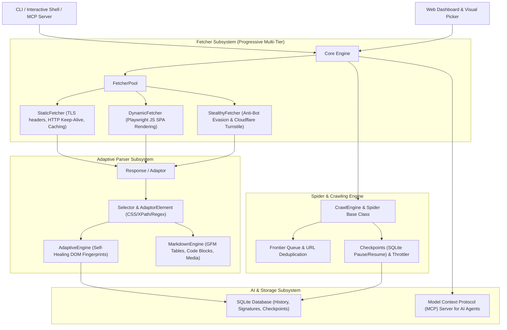

# 🕷️ Scrapi (v2.0 - Scrapling Engine Architecture)

An ultra-fast, adaptive, developer-grade web scraping and crawling framework in Node.js, re-architected with inspiration from [D4Vinci/Scrapling](https://github.com/D4Vinci/Scrapling).

---

## 🏛️ Scrapi v2.0 Architecture

Scrapi is structured into 4 decoupled, high-performance subsystems:



---

## 🚀 Key Capabilities

### 1. Progressive Multi-Tier Fetchers
- **`StaticFetcher`**: Ultra-fast HTTP client using connection pooling, TLS-like headers, automatic gzip/brotli decompression, conditional ETag/304 HTTP caching, and exponential backoff retry.
- **`DynamicFetcher`**: Playwright headless browser client for rendering dynamic JavaScript single-page apps (SPAs), selector waiting, and auto-scrolling.
- **`StealthyFetcher`**: Anti-bot evasion engine that masks `navigator.webdriver`, simulates Chrome runtime, handles permissions queries, injects canvas noise, and automates Cloudflare Turnstile challenge solving.

### 2. Adaptive Self-Healing Parser & Fluent Selectors
- **Unified `Response` Adaptor**: Every fetcher returns a consistent `Response` object with `.css()`, `.xpath()`, `.toMarkdown()`, `.extractMetadata()`, and `.json()`.
- **Self-Healing DOM Fingerprints**: When website redesigns break CSS selectors, the `AdaptiveEngine` uses multi-anchor similarity algorithms (structural paths, tag hierarchies, text snippets, class frequencies) to automatically relocate the intended element.

### 3. Scrapy-like Spider Framework & Checkpoints
- **Concurrent Crawl Engine**: Async crawling loop with link frontier queues, URL deduplication, depth budgeting, and auto-throttling.
- **Pause & Resume Checkpoints**: Saves crawl state to SQLite so large site crawls can be stopped and resumed seamlessly (`--resume`).

### 4. Interactive REPL Shell (`scrapi shell`)
- Test CSS selectors, XPath queries, and markdown extraction live in a Node.js REPL console.

### 5. Built-in Model Context Protocol (MCP) Server (`scrapi mcp`)
- Exposes tools (`scrapi_fetch`, `scrapi_extract`, `scrapi_adaptive_query`, `scrapi_crawl`) over JSON-RPC stdio for AI coding assistants like Claude, Cursor, and Antigravity.

---

## 💻 CLI Commands

### 1. Scrape with Multi-Tier Fetchers
```bash
# High-speed static fetch
node src/cli.js scrape https://example.com --fetcher static

# Dynamic JavaScript rendering (Playwright)
node src/cli.js scrape https://example.com --fetcher dynamic

# Stealth anti-bot bypass mode
node src/cli.js scrape https://example.com --fetcher stealth

# Scrape with custom selector and local media download
node src/cli.js scrape https://example.com -s "article" --download-media
```

### 2. Interactive Scraper Shell (REPL)
```bash
node src/cli.js shell https://example.com
```
Inside the shell:
```javascript
// Test CSS queries
response.css('h1').texts

// Test XPath queries
response.xpath('//a').cleanTexts

// Convert to clean Markdown
response.toMarkdown()
```

### 3. MCP Server for AI Integration
```bash
node src/cli.js mcp
```

### 4. Recursive Site Spider with Checkpoints
```bash
node src/cli.js spider https://example.com -d 3 -m 50 -c 4 --delay 500

# Resume a previous crawl
node src/cli.js spider https://example.com --resume example.com-spider
```

### 5. Category-Targeted Crawling
```bash
node src/cli.js crawl https://example.com -s "div.post-card a" --category blog
```

### 6. Web Dashboard UI
```bash
node src/cli.js serve --port 3000
```

---

## 🧪 Programmatic Node.js API

```javascript
import { fetch, fetchDynamic, fetchStealth, SelectorList, AdaptiveEngine } from 'scrapi';

// Fetch a web page
const response = await fetch('https://example.com');

// CSS & XPath queries
const title = response.css('h1').first().cleanText;
const links = response.xpath('//a').attribs('href');

// Convert to GFM Markdown
const { markdown, metadata } = response.toMarkdown();

// Self-healing adaptive query
const healed = response.adaptive({
  tagName: 'article',
  textSnippet: 'Important news item',
  classes: ['post-entry']
});
console.log('Target element:', healed.element.text);
```