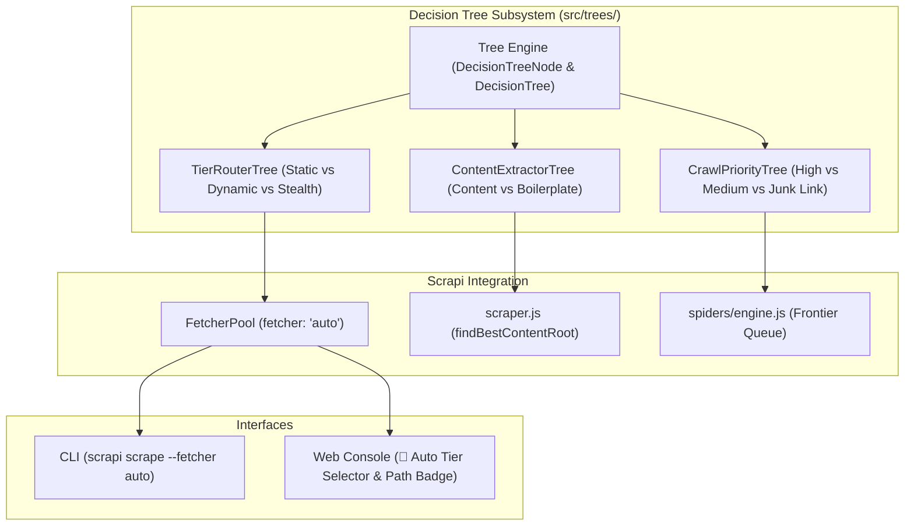
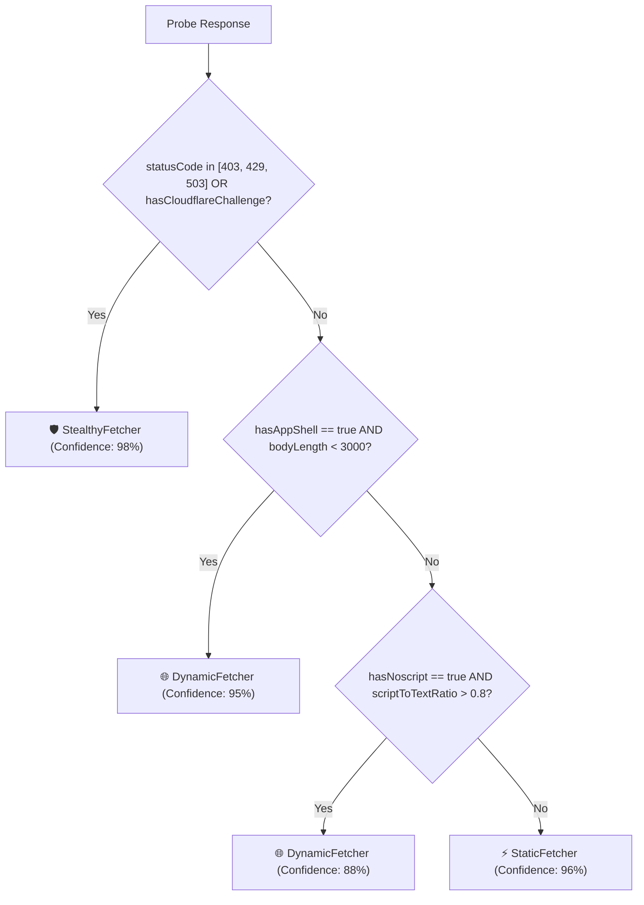

# Implementation Plan: Decision Tree Integration in Scrapi v2.0

This plan outlines the architecture, design, and integration of an interpretable, sub-millisecond **Decision Tree Subsystem** (`src/trees/`) into Scrapi. The decision tree engine will power autonomous multi-tier fetcher routing, DOM content extraction & noise pruning, and crawl frontier link prioritization without requiring heavy external machine-learning dependencies.

---

## User Review Required

> [!IMPORTANT]
> The Decision Tree engine will be written in **pure JavaScript (zero external C++/Python dependencies)**, running entirely in Node.js. It operates in **microseconds (<50 µs)** per evaluation, introducing zero noticeable latency.
>
> We propose introducing a new `--fetcher auto` option (or default) across the CLI and Web Console that uses the **Autonomous Tier Router Tree** to automatically select `static`, `dynamic`, or `stealth` based on real-time probe signals.

---

## 1. Problem Statement & Motivation

Currently in Scrapi:
1. **Manual Tier Selection**: Users must manually specify `--fetcher static|dynamic|stealth`. If a static fetch fails due to Cloudflare or client-side JavaScript SPA hydration, the user must re-run with `--fetcher dynamic` or `--fetcher stealth`.
2. **Heuristic DOM Root Extraction**: `findBestContentRoot()` relies on hardcoded tag priority (`article`, `main`) and basic text length checks, which can misidentify boilerplate sidebars or navigation bars on complex modern web apps.
3. **FIFO Crawl Queue**: The Spider crawls all internal links in First-In-First-Out order without prioritizing high-value content pages over pagination or duplicate URLs.

A **Decision Tree** solves all three problems with deterministic, interpretable, and high-speed rule-based classification.

---

## 2. Proposed Architecture & Decision Trees



---

## 3. Detailed Component Specifications

### Component A: Core Decision Tree Engine (`src/trees/engine.js`)
* **`DecisionTreeNode`**:
  * For split nodes: `feature`, `operator` (`<`, `<=`, `>`, `>=`, `==`, `in`, `contains`), `threshold`, `left`, `right`.
  * For leaf nodes: `value`, `confidence`, `label`, `metadata`.
* **`DecisionTree`**:
  * `predict(features)`: Traverses branches and returns the leaf prediction.
  * `explain(features)`: Traverses branches and returns `{ result, confidence, path: ['feature > threshold', ...] }` for explainability.
  * `toJSON()` / `fromJSON()`: Serialization for persistence and inspection.

---

### Component B: Autonomous Fetcher Tier Router (`src/trees/tier_router.js`)
Evaluates initial probe signals (HTTP status, headers, HTML size, script markers) to choose between `static`, `dynamic`, and `stealth`.

#### Feature Extraction Map:
| Feature Name | Type | Description |
|---|---|---|
| `statusCode` | number | HTTP response status (200, 403, 429, 503) |
| `bodyLength` | number | Length of raw HTML response in bytes |
| `hasCloudflareChallenge` | boolean | Presence of `Just a moment...`, `turnstile`, `cf-browser-verification` |
| `hasAppShell` | boolean | Presence of `<div id="root"></div>`, `id="__next"`, `<app-root>` with empty body |
| `hasNoscript` | boolean | Page contains `<noscript>` indicating JS requirement |
| `scriptToTextRatio` | number | Proportion of script tags relative to text content |
| `linkDensity` | number | Anchor text length relative to total text |

#### Decision Tree Traversal Rules:


---

### Component C: DOM Content Extractor Tree (`src/trees/content_extractor.js`)
Classifies DOM nodes into `MAIN_CONTENT`, `BOILERPLATE`, or `AD_POPUP` to isolate clean article content with precision.

#### Node Feature Map:
| Feature | Calculation |
|---|---|
| `linkDensity` | `anchorTextLength / totalTextLength` (high in nav/footers) |
| `textLength` | Clean inner text character count |
| `pTagCount` | Number of `<p>` paragraphs contained within the node |
| `negativeTokenCount` | Class/ID containing `sidebar`, `comment`, `footer`, `nav`, `menu`, `widget`, `ad` |
| `positiveTokenCount` | Class/ID containing `article`, `post`, `entry`, `content`, `main`, `story` |
| `tagDepth` | Depth from `<body>` tag |

Integrated into `findBestContentRoot()` in `src/scraper.js` and `src/parser/adaptor.js`.

---

### Component D: Crawl Priority Tree (`src/trees/crawl_prioritizer.js`)
Ranks discovered links in the spider frontier queue:
* **`HIGH` (Score: 100)**: Links matching content path patterns (`/article/`, `/post/`, `/blog/`, `/item/`).
* **`MEDIUM` (Score: 50)**: Index/listing/category paths (`/category/`, `/page/`, `/tag/`).
* **`SKIP / LOW` (Score: 0)**: Non-content noise (`/login`, `/cart`, `?sort=`, `?replytocom=`, `/cdn-cgi/`).

---

## 4. Proposed File Changes

### [NEW] `src/trees/engine.js`
Zero-dependency Decision Tree evaluator with `predict()` and `explain()`.

### [NEW] `src/trees/tier_router.js`
Pre-trained tier routing tree with probe feature extraction and tier prediction (`static` / `dynamic` / `stealth`).

### [NEW] `src/trees/content_extractor.js`
DOM node classifier for intelligent content root isolation and noise removal.

### [NEW] `src/trees/crawl_prioritizer.js`
Spider frontier link scoring and classification.

### [NEW] `src/trees/index.js`
Unified export interface for the `trees` module.

### [MODIFY] `src/fetchers/index.js`
* Add support for `options.fetcher = 'auto'` in `FetcherPool.fetch()`.
* When `'auto'` is set, runs probe check, evaluates `TierRouterTree`, logs decision path explanation, and executes optimal tier.

### [MODIFY] `src/scraper.js`
* Update `findBestContentRoot()` to utilize `ContentExtractorTree.classify()` for selecting the best content container.

### [MODIFY] `src/spiders/engine.js`
* Use `CrawlPriorityTree` to score and sort the frontier queue so high-value content pages are crawled first.

### [MODIFY] `src/cli.js`
* Add `'auto'` as the default or selectable option for `--fetcher <type>` (`auto`, `static`, `dynamic`, `stealth`).
* Output decision explanation path when `--auto` is used.

### [MODIFY] `src/ui/app.jsx` & `src/ui/server.js`
* Add **🤖 Auto (Decision Tree)** option to the Render Mode selector in the Web Console.
* Display the live decision path badge in the UI (e.g. `Auto: Static (96% Confidence)`).

### [NEW] `test_decision_tree.js`
Comprehensive test suite verifying tree construction, split evaluations, explanation paths, tier routing, content pruning, and link prioritization.

### [MODIFY] `src/benchmark/parser.js` & `benchmark.js`
Add Decision Tree inference latency benchmark (verifying sub-millisecond execution).

### [NEW] `docs/decision_tree_architecture.md`
Complete architectural guide detailing decision trees, feature engineering, and benchmarks.

---

## 5. Verification Plan

### Automated Tests
1. **Decision Tree Unit & Integration Suite**:
   ```bash
   node test_decision_tree.js
   ```
   * Verifies tree node traversal (`<`, `<=`, `>`, `>=`, `==`, `in`).
   * Verifies `explain()` produces accurate, readable traversal traces.
   * Verifies `TierRouterTree` correctly routes:
     - Plain HTML $\rightarrow$ `static`
     - React empty root container $\rightarrow$ `dynamic`
     - 403 / Cloudflare challenge page $\rightarrow$ `stealth`
   * Verifies `ContentExtractorTree` isolates article bodies and rejects sidebars/navigation.
   * Verifies `CrawlPriorityTree` ranks article links above pagination/login traps.

2. **Master Test Suite Regression**:
   ```bash
   npm test
   ```
   * Verifies existing test suites (`test_scrapling_arch.js`, `test_spider.js`, `test_optimizations.js`) pass cleanly.

3. **Performance Benchmark Suite**:
   ```bash
   npm run benchmark
   ```
   * Verifies decision tree evaluation latency is < 50 µs per call.

### Manual Verification
1. Test CLI with autonomous routing:
   ```bash
   node src/cli.js scrape https://example.com --fetcher auto
   ```
2. Open Web Console (`node src/cli.js serve`) and verify the **🤖 Auto** tier button works and displays the decision path explanation toast/badge.
