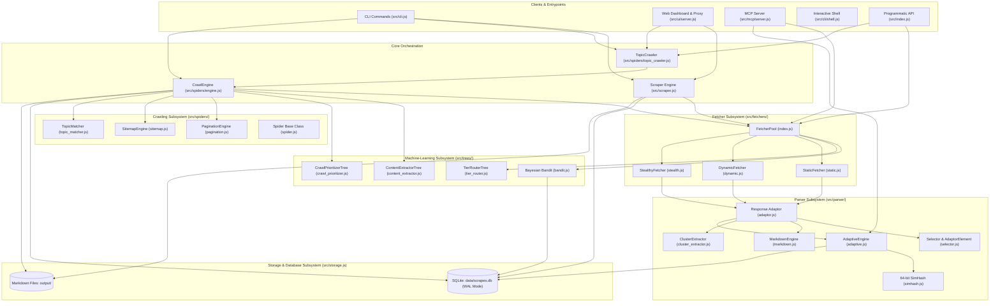
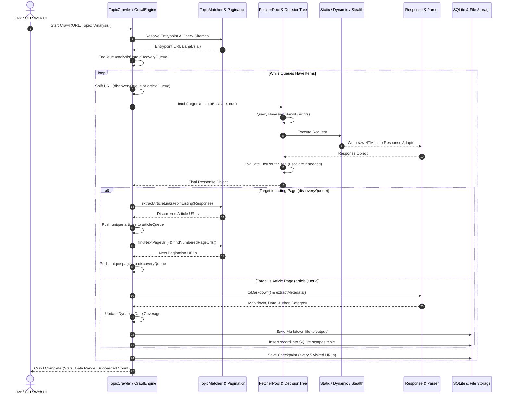

# 🏛️ System Architecture: Scrapi v2.0

## 1. High-Level Architectural Model

Scrapi v2.0 is organized into decoupled subsystems that isolate networking, machine-learning decision engines, DOM parsing, crawl coordination, and persistence:

---

## 2. Core Subsystems & Component Responsibilities

### 2.1 Entrypoint & Presentation Layer
Provides external interfaces to invoke scraping, crawling, and parsing:
- **CLI Driver ([`src/cli.js`](../src/cli.js))**: Commander-based command-line interface defining 15 subcommands (`scrape`, `crawl`, `topic`, `spider`, `shell`, `mcp`, `serve`, `batch`, `list`, `show`, `export`, `discover`, `benchmark`, `entities`, `bandit`).
- **Interactive Shell ([`src/cli/shell.js`](../src/cli/shell.js))**: Node.js REPL session preloading a target `Response` object for live query testing.
- **MCP Server ([`src/mcp/server.js`](../src/mcp/server.js))**: JSON-RPC 2.0 stdio server implementing the Model Context Protocol for AI coding assistants.
- **Web UI Server ([`src/ui/server.js`](../src/ui/server.js))**: Express backend providing REST endpoints for scraping, spider state polling, and the visual selector picker iframe proxy.

### 2.2 Machine-Learning & Routing Subsystem (`src/trees/`)
Guides execution tier selection, content extraction, and crawl prioritization:
- **`DecisionTree` & `CARTTrainer` ([`src/trees/engine.js`](../src/trees/engine.js))**: Binary decision tree implementation supporting Gini impurity calculations, continuous split finding, cost-complexity pruning, and Random Forest ensembles.
- **`TierRouterTree` ([`src/trees/tier_router.js`](../src/trees/tier_router.js))**: Evaluates incoming HTML features (body length, script tag ratio, React/Next.js SPA markers, Cloudflare challenge signatures) to determine if a static request must escalate to `DYNAMIC` or `STEALTH`.
- **`ContentExtractorTree` ([`src/trees/content_extractor.js`](../src/trees/content_extractor.js))**: Scores DOM elements using text length, link density, tag weight, and class name sentiment to classify nodes as `MAIN_CONTENT` or `NOISE`.
- **`CrawlPriorityTree` ([`src/trees/crawl_prioritizer.js`](../src/trees/crawl_prioritizer.js))**: Ranks discovered links (0–100) based on URL depth, pathname tokens, anchor text semantics, and tracking query noise.
- **`BayesianBandit` ([`src/trees/bandit.js`](../src/trees/bandit.js))**: Maintains Beta distribution priors $(\alpha, \beta)$ per domain. Once a domain's defense probability exceeds 85%, it triggers **Probe Bypass**, launching directly into `DYNAMIC` or `STEALTH` without wasting time on a failed static probe.

### 2.3 Fetcher Subsystem (`src/fetchers/`)
Handles networking, HTTP connection reuse, browser automation, and bot evasion:
- **`BaseFetcher` ([`src/fetchers/base.js`](../src/fetchers/base.js))**: Abstract base class establishing timeout defaults, randomized User-Agent rotation, exponential backoff retries, and timing calculations.
- **`StaticFetcher` ([`src/fetchers/static.js`](../src/fetchers/static.js))**: Axios-based client with persistent HTTP/HTTPS agents (`keepAlive: true`), Brotli/Gzip decompression, and conditional caching via SQLite table `http_cache`.
- **`DynamicFetcher` ([`src/fetchers/dynamic.js`](../src/fetchers/dynamic.js))**: Playwright headless Chromium client managing a shared browser process, page recycling, auto-scrolling, and DOM selector waiting.
- **`StealthyFetcher` ([`src/fetchers/stealth.js`](../src/fetchers/stealth.js))**: Anti-bot browser engine injecting evasive runtime shims (`navigator.webdriver`, WebGL vendor spoofing, canvas noise, Chrome plugin lists) and auto-solving Cloudflare Turnstile checkboxes.
- **`FetcherPool` ([`src/fetchers/index.js`](../src/fetchers/index.js))**: Singleton pool coordinating fetcher instances, routing through the Bayesian Bandit and TierRouter tree, and handling auto-escalation.

### 2.4 Parser & Self-Healing Subsystem (`src/parser/`)
Parses HTML, resolves elements, extracts structured metadata, and generates Markdown:
- **`Response` Adaptor ([`src/parser/adaptor.js`](../src/parser/adaptor.js))**: Unified abstraction returned by all fetchers. Wraps raw HTML with Cheerio, strips noise scripts, resolves relative URLs, and provides `.css()`, `.xpath()`, `.toMarkdown()`, and `.extractMetadata()`.
- **`AdaptorElement` & `SelectorList` ([`src/parser/selector.js`](../src/parser/selector.js))**: Fluent element wrappers providing chainable methods (`.text`, `.cleanText`, `.attr()`, `.attribs()`, `.texts`, `.xpath()`, `.css()`).
- **`SimHash` ([`src/parser/simhash.js`](../src/parser/simhash.js))**: 64-bit FNV-1a locality-sensitive hashing algorithm converting element structural paths, tag hierarchies, classes, and text into a 64-bit BigInt fingerprint.
- **`AdaptiveEngine` ([`src/parser/adaptive.js`](../src/parser/adaptive.js))**: Evaluates candidate elements against stored fingerprints using Hamming distance similarity to relocate moved or renamed elements after website redesigns.
- **`ClusterExtractor` ([`src/parser/cluster_extractor.js`](../src/parser/cluster_extractor.js))**: Unsupervised structural induction algorithm that groups repeating DOM subtree signatures to extract product or article card collections.
- **`MarkdownEngine` ([`src/parser/markdown.js`](../src/parser/markdown.js))**: Turndown-based converter configured with GitHub-Flavored Markdown (tables, code blocks, checklists) and YAML frontmatter generation.

### 2.5 Crawling Subsystem (`src/spiders/`)
Coordinates multi-page traversal, topic filtering, pagination, and persistent state:
- **`CrawlEngine` ([`src/spiders/engine.js`](../src/spiders/engine.js))**: Core crawling coordinator operating a worker pool across dual queues: `discoveryQueue` for listing/pagination navigation, and `articleQueue` for content scraping. Tracks dynamic publication date ranges and saves periodic checkpoints.
- **`TopicCrawler` ([`src/spiders/topic_crawler.js`](../src/spiders/topic_crawler.js))**: High-level orchestrator that resolves topic entrypoints, configures exhaustive crawling parameters, and manages end-to-end topic execution.
- **`TopicMatcher` ([`src/spiders/topic_matcher.js`](../src/spiders/topic_matcher.js))**: Normalizes topic slugs, tests URL segment tokens, excludes system noise paths (`/login`, `/cart`, `wp-admin`), and classifies page roles (`LISTING_PAGE`, `ARTICLE_PAGE`, `ARCHIVE_PAGE`).
- **`PaginationEngine` ([`src/spiders/pagination.js`](../src/spiders/pagination.js))**: Identifies Next Page links, numbered pagination buttons, subcategories, and archive directories, checking depletion markers to prevent infinite loops.
- **`SitemapEngine` ([`src/spiders/sitemap.js`](../src/spiders/sitemap.js))**: Probes `robots.txt` and XML sitemaps to uncover historical topic URLs.
- **`Spider` ([`src/spiders/spider.js`](../src/spiders/spider.js))**: Scrapy-inspired base class for defining custom programmatic spiders with `startUrls` and `parse()` callbacks.

### 2.6 Database & Storage Subsystem (`src/storage.js`)
Manages persistence via SQLite and filesystem storage:
- **SQLite Engine**: Utilizes `better-sqlite3` with Write-Ahead Logging (`WAL` mode) for synchronous and concurrent read/write performance.
- **Schema Management**: Creates tables for scrape records (`scrapes`), visual profiles (`profiles`), HTTP cache (`http_cache`), LLM cache (`llm_cache`), crawl checkpoints (`spider_checkpoints`), DOM element fingerprints (`element_fingerprints`), and domain bandit priors (`bandit_domain_priors`).
- **Filesystem Mapping**: Organizes output Markdown files into hierarchical domain and category subfolders (e.g. `./output/example.com/analysis/article-1.md`) alongside metadata sidecar JSON files.

---

## 3. Component Interaction Diagram

