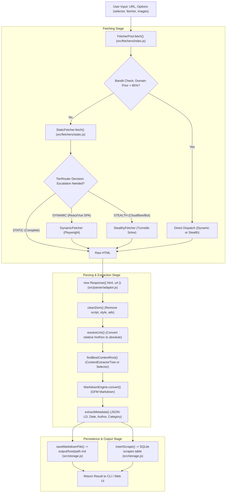
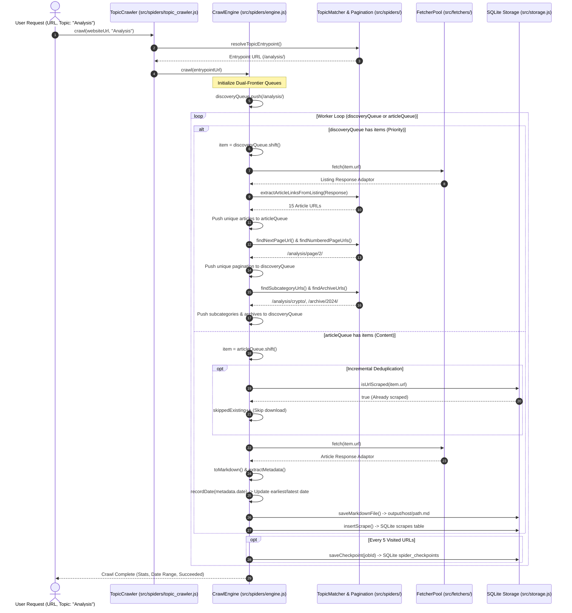
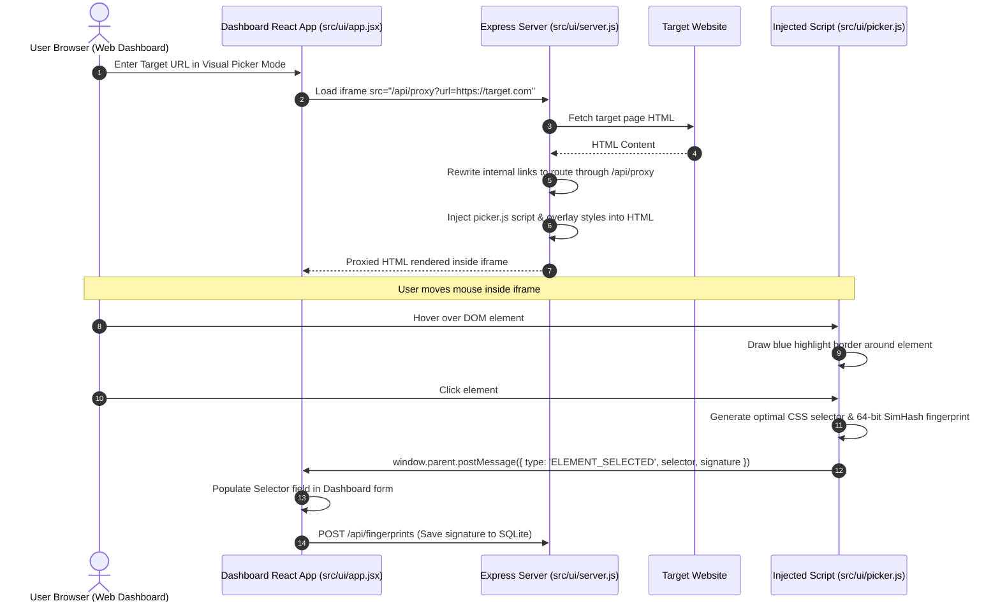
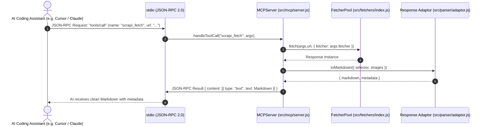

# 🔄 Data Flow: Scrapi v2.0

This document traces the exact step-by-step movement of data through Scrapi v2.0 across its major operational pipelines.

---

## 1. Single URL Scraping Pipeline

When a user requests a single page scrape via CLI (`scrapi scrape <url>`) or Web Dashboard (`POST /api/scrape`), data flows through five sequential stages:

### Stage-by-Stage Trace:
1. **Input Reception**: [`src/cli.js`](../src/cli.js) or [`src/ui/server.js`](../src/ui/server.js) parses CLI flags or JSON payload into an options dictionary: `{ url, fetcher: 'auto', selector: 'auto', downloadMedia: false, ... }`.
2. **Bandit Consultation**: [`FetcherPool.fetch()`](../src/fetchers/index.js) queries [`BayesianBandit.shouldBypassProbe(domain)`](../src/trees/bandit.js). If the domain's defense probability exceeds 85%, the static probe is bypassed directly to `DYNAMIC` or `STEALTH`.
3. **Execution & Escalation**:
   - `StaticFetcher.fetch()` makes an HTTP request with connection pooling and conditional caching headers.
   - If `autoEscalate: true`, the raw HTML is sent to [`TierRouterTree.predict()`](../src/trees/tier_router.js).
   - If classified as `DYNAMIC` (client-rendered SPA) or `STEALTH` (anti-bot challenge), `FetcherPool` auto-dispatches the higher tier.
4. **DOM Wrapping**: The resulting HTML is wrapped in [`Response`](../src/parser/adaptor.js).
   - `this.$` lazily creates a Cheerio instance with noise scripts stripped.
   - `resolveUrls()` converts relative `href` and `src` attributes into absolute URLs based on `response.url`.
5. **Content Extraction**:
   - [`findBestContentRoot()`](../src/parser/adaptor.js) locates the primary container using CSS selector, self-healing fingerprint, or [`scoreContentElement()`](../src/trees/content_extractor.js).
   - [`MarkdownEngine.convert()`](../src/parser/markdown.js) converts the content DOM subtree into clean GitHub-Flavored Markdown.
   - [`extractMetadata()`](../src/parser/adaptor.js) inspects JSON-LD script blocks, `<meta>` tags, and `<time>` tags to populate title, date, author, category, tags, and canonical URL.
6. **Storage**:
   - [`saveMarkdownFile()`](../src/storage.js) writes the Markdown file with YAML frontmatter to `./output/<domain>/<path>.md`.
   - [`insertScrape()`](../src/storage.js) logs the URL, title, word count, timestamp, and status into SQLite `scrapes`.

---

## 2. Exhaustive Topic Crawling Pipeline

When executing a topic crawl via CLI (`scrapi topic <url> <topic>`) or Web Dashboard (`POST /api/topic/crawl`), data flows through a **dual-frontier asynchronous queue system**:

---

## 3. Visual Selector Picker Data Flow

When a user uses the Visual Picker in the Web Dashboard (`src/ui/app.jsx`), data flows through an **injected iframe proxy**:

---

## 4. MCP Server AI Integration Flow

When an AI coding assistant (Cursor, Claude, Antigravity) uses Scrapi via Model Context Protocol:

