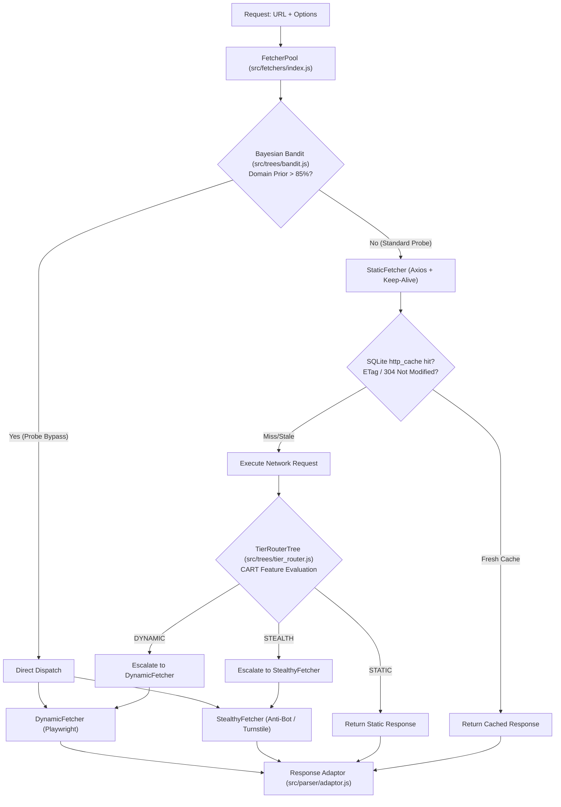

# 🌐 Fetchers & Networking: Scrapi v2.0

## 1. Fetcher Subsystem Overview

The Fetcher Subsystem ([`src/fetchers/`](../src/fetchers/)) provides progressive multi-tier web page retrieval. Instead of forcing all URLs through a heavy headless browser or failing on client-rendered SPAs with a basic HTTP client, Scrapi dynamically escalates through three tiers:

---

## 2. Fetcher Implementations

### 2.1 `BaseFetcher` ([`src/fetchers/base.js`](../src/fetchers/base.js))
Abstract base class defining common networking behavior:
- **Default Headers**: Modern Chrome User-Agents rotated randomly across requests (`Windows NT 10.0; Win64; x64`, `Macintosh; Intel Mac OS X 10_15_7`).
- **Timing**: Measures execution latency in milliseconds (`Date.now() - startTime`).
- **Retry Logic**: Configurable exponential backoff retries for transient HTTP errors (5xx, 429, timeouts).

---

### 2.2 `StaticFetcher` ([`src/fetchers/static.js`](../src/fetchers/static.js))
Lightweight, ultra-fast HTTP client designed for maximum throughput on static and server-side rendered pages.
- **HTTP Keep-Alive**: Configures persistent `http.Agent` and `https.Agent` (`keepAlive: true`, `maxSockets: 50`) to reuse TCP and TLS handshakes.
- **Decompression**: Automatic streaming decompression for `br` (Brotli), `gzip`, and `deflate`.
- **Conditional HTTP Caching**:
  - Before requesting, checks SQLite table `http_cache` for stored `etag` or `last_modified`.
  - Sends conditional headers: `If-None-Match: <etag>` and `If-Modified-Since: <last_modified>`.
  - On HTTP `304 Not Modified`, retrieves the cached HTML body from SQLite, saving bandwidth and latency.
  - On HTTP `200 OK`, updates the SQLite `http_cache` with fresh content and headers.

---

### 2.3 `DynamicFetcher` ([`src/fetchers/dynamic.js`](../src/fetchers/dynamic.js))
Headless browser client powered by Playwright Chromium for rendering client-side JavaScript applications.
- **Shared Browser Instance**: Reuses a single `sharedBrowser` process across requests to eliminate the 500ms–1000ms browser startup overhead.
- **Isolated Contexts**: Creates a new, isolated browser context and page per request, preventing cookie and session bleeding.
- **Auto-Scrolling**: Automatically scrolls down the page in increments to trigger lazy-loaded images, dynamic widgets, and infinite feed content.
- **Selector Waiting**: Supports `waitForSelector` to pause execution until specific asynchronous elements appear in the DOM.

---

### 2.4 `StealthyFetcher` ([`src/fetchers/stealth.js`](../src/fetchers/stealth.js))
Advanced browser evasion engine engineered to bypass enterprise bot detection (Cloudflare, PerimeterX, DataDome, Akamai):
- **Webdriver Masking**: Deletes `navigator.webdriver` and injects authentic Chrome runtime objects (`window.chrome`).
- **Hardware & Canvas Spoofing**: Injects noise into HTML5 Canvas `toDataURL` and WebGL vendor/renderer strings (`ANGLE (Apple, Apple M-series, OpenGL 4.1)`).
- **Automated Cloudflare Turnstile Solver**:
  1. Searches for Turnstile iframe containers (`iframe[src*="challenges.cloudflare.com"]`, `iframe[src*="turnstile"]`).
  2. Traverses child frames to locate the interactive checkbox (`input[type="checkbox"]`, `.cb-i`, `#challenge-stage`).
  3. Simulates human mouse movement and clicks the verification box.
  4. Waits up to 10 seconds for the challenge response token to be submitted before capturing HTML.

---

## 3. Orchestration & Selection Logic (`FetcherPool`)

The [`FetcherPool`](../src/fetchers/index.js) orchestrates fetcher selection via two complementary mechanisms:

### 3.1 CART Decision Tree Escalation (`TierRouterTree`)
When a request runs in `'auto'` mode (`autoEscalate: true`), `FetcherPool` first executes a fast static probe. The resulting HTML is fed into [`TierRouterTree.predict()`](../src/trees/tier_router.js), which evaluates 11 features:
- `bodyLength`: HTML document size in bytes.
- `scriptCount` & `scriptRatio`: Density of `<script>` tags relative to text content.
- `spaConfidence`: Detection of client-side mount points (`#root`, `#app`, `#__next`, `[data-reactroot]`).
- `challengeConfidence`: Detection of challenge markers (`cf-browser-verification`, `challenge-platform`, `perimeterx`, `turnstile`).
- `metaRefresh`: Presence of `<meta http-equiv="refresh">` redirect loaders.

If the tree returns `DYNAMIC` or `STEALTH`, `FetcherPool` discards the static probe and dispatches the higher tier.

### 3.2 Bayesian Bandit Probe Bypass
To prevent wasting a 100ms static probe on domains known to require JavaScript or stealth, the [`BayesianBandit`](../src/trees/bandit.js) tracks empirical success and failure distributions across domains.
- Each domain maintains a Beta distribution: $\text{Beta}(\alpha, \beta)$.
- When `bandit.shouldBypassProbe(domain)` exceeds $0.85$ (85% certainty), `FetcherPool` **bypasses the static probe entirely**, launching directly into `DYNAMIC` or `STEALTH`.

---

## 4. Resource Management & Cleanup

To avoid memory leaks from orphan Playwright processes, Scrapi provides:
- **`closeSharedBrowser()`** ([`src/fetchers/dynamic.js`](../src/fetchers/dynamic.js)): Closes the shared Playwright Chromium instance.
- **`closeAllFetchers()`** ([`src/fetchers/index.js`](../src/fetchers/index.js)): High-level helper called at crawl or test completion to terminate all active browser contexts and background timers.
