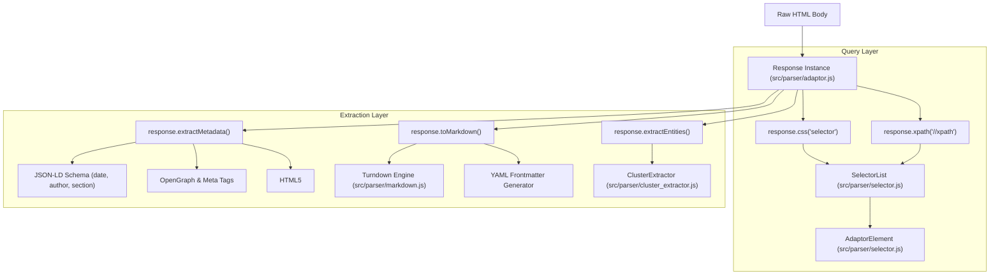

# 🔍 Parsers & Selectors: Scrapi v2.0

## 1. Parser Subsystem Overview

The Parser Subsystem ([`src/parser/`](../src/parser/)) provides unified, fluent DOM querying, metadata extraction, structural pattern induction, and Markdown generation across all fetcher outputs.



---

## 2. The `Response` Adaptor Class ([`src/parser/adaptor.js`](../src/parser/adaptor.js))

All fetcher tiers return an instance of `Response`. It unifies Cheerio DOM parsing, metadata extraction, and URL resolution.

### Properties
- `url` *(string)*: The requested URL.
- `status` *(number)*: HTTP status code (e.g. 200, 404).
- `headers` *(object)*: HTTP response headers.
- `rawHtml` *(string)*: Raw unparsed HTML string.
- `fetcher` *(string)*: Name of the fetcher tier used (`'static'`, `'dynamic'`, `'stealth'`).
- `timing` *(number)*: Total fetch latency in milliseconds.
- `$` *(getter)*: Lazily loaded Cheerio instance with noise tags (`<script>`, `<style>`, `<svg>`) stripped for high-speed selector parsing.
- `fullDom` *(getter)*: Full unstripped Cheerio instance preserving `<script type="application/ld+json">` for schema extraction.

### Core Methods
- **`css(selector)`**: Queries elements via CSS selector, returning a `SelectorList`.
- **`xpath(xpathQuery)`**: Evaluates XPath expressions across the DOM.
- **`cleanDom()`**: Strips `NOISE_SELECTORS` (nav, header, footer, ads, cookie banners).
- **`resolveUrls()`**: Resolves relative `href` and `src` attributes to absolute URLs based on `this.url`.
- **`extractMetadata()`**: Extracts title, description, publication date, author, category, tags, and canonical URL.
- **`toMarkdown(options)`**: Converts content to GitHub-Flavored Markdown with YAML frontmatter.
- **`extractEntities(options)`**: Executes unsupervised structural clustering to extract product or article card collections.

---

## 3. Selectors & Fluent Traversal (`src/parser/selector.js`)

Scrapi wraps Cheerio nodes in fluent, chainable classes inspired by modern web scraping ergonomics:

### 3.1 `AdaptorElement`
Wraps an individual DOM element:
- **`.text`**: Trimmed inner text content.
- **`.cleanText`**: Single-line normalized text (whitespace collapsed).
- **`.tag`**: Lowercase tag name (e.g. `'article'`, `'h1'`).
- **`.html`**: Outer HTML string of the element.
- **`.innerHtml`**: Inner HTML string.
- **`.attr(name)`**: Retrieves attribute value. If `name === 'href'` or `'src'`, automatically resolves relative URLs to absolute.
- **`.css(selector)`**: Sub-query elements within this element's subtree.
- **`.xpath(xpathQuery)`**: Evaluates XPath queries relative to this element.

### 3.2 `SelectorList`
Array-like collection of `AdaptorElement` instances:
- **`.first()`**: Returns the first `AdaptorElement` or an empty dummy element.
- **`.last()`**: Returns the last `AdaptorElement`.
- **`.get(index)`**: Returns element at index.
- **`.texts`**: Array of trimmed text strings across all matched elements:
  ```javascript
  const titles = response.css('h2.post-title').texts;
  // ['First Article', 'Second Article', ...]
  ```
- **`.cleanTexts`**: Array of whitespace-collapsed text strings.
- **`.attribs(attrName)`**: Array of attribute values across all matched elements:
  ```javascript
  const links = response.css('div.posts a').attribs('href');
  // ['https://example.com/p/1', 'https://example.com/p/2', ...]
  ```

---

## 4. Metadata Extraction Pipeline

[`Response.extractMetadata()`](../src/parser/adaptor.js) extracts structured metadata through a prioritized resolution hierarchy:

### 4.1 Publication Date Extraction
1. **JSON-LD Schema**: Scans `<script type="application/ld+json">` for `datePublished`, `dateCreated`, or `dateModified`.
2. **Meta Selectors (`DATE_META_SELECTORS`)**: Checks `article:published_time`, `og:article:published_time`, `date`, `pubdate`, `DC.date`, `parsely-pub-date`.
3. **HTML5 `<time>`**: Checks `time[datetime]`.
4. **Microdata**: Checks `[itemprop="datePublished"]`.
5. **Class Heuristics**: Checks `.published`, `.post-date`.
6. **URL Date Regex Fallback**: If no DOM date exists, scans URL path for date patterns (`/2024/01/15/slug`):
   ```javascript
   export const DATE_REGEX = /\b(19\d\d|20\d\d)[/-](0[1-9]|1[0-2])(?:[/-](0[1-9]|[12]\d|3[01]))?\b/;
   ```
7. **Normalization (`normalizeDate`)**: Converts matched dates to standardized ISO `YYYY-MM-DD` strings.

### 4.2 Author & Category Extraction
- **Author**: Prioritizes JSON-LD `author` (object or array), followed by `meta[name="author"]`, `meta[property="article:author"]`, `rel="author"`, `.author-name`, `.byline`.
- **Category**: Prioritizes JSON-LD `articleSection`, followed by `meta[property="article:section"]`, `meta[name="section"]`, and breadcrumb hierarchies (`.breadcrumb a`).

---

## 5. Markdown Conversion Engine ([`src/parser/markdown.js`](../src/parser/markdown.js))

The Markdown Engine converts DOM trees into clean, LLM-ready GitHub-Flavored Markdown:
- **Turndown Service**: Configured with heading style `'atx'` (`# Heading`), bullet markers (`-`), and code fence blocks (` ``` `).
- **GFM Plugin (`turndown-plugin-gfm`)**: Retains structured table formatting (`| col | col |`), strikethrough, and task checklists.
- **Image Handling**: If `options.images === false`, image tags are stripped to save tokens. If `true`, converted to standard Markdown ``.
- **YAML Frontmatter**: Automatically prepends document metadata:
  ```markdown
  ---
  title: "Latest AI Breakthrough 2026"
  url: "https://example.com/analysis/breakthrough"
  canonical_url: "https://example.com/analysis/breakthrough"
  date: "2026-10-14"
  author: "Dr. Antigravity"
  category: "Analysis"
  tags: ["AI", "Agents", "Research"]
  scraped_at: "2026-10-16T17:00:00.000Z"
  ---

  # Latest AI Breakthrough 2026
  ...
  ```

---

## 6. Unsupervised Entity Clustering ([`src/parser/cluster_extractor.js`](../src/parser/cluster_extractor.js))

When scraping product catalogs, real estate listings, or news cards without predefined selectors, [`extractEntities()`](../src/parser/cluster_extractor.js) groups repeating elements:
1. Generates structural tag signatures for child trees (e.g. `DIV > H2 + SPAN.price + A`).
2. Clusters elements sharing identical or high-similarity structural signatures.
3. Maps leaf nodes into semantic entity fields (`title`, `price`, `url`, `image`, `badge`).
