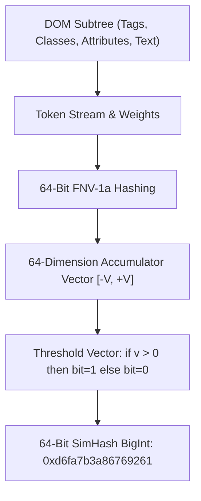
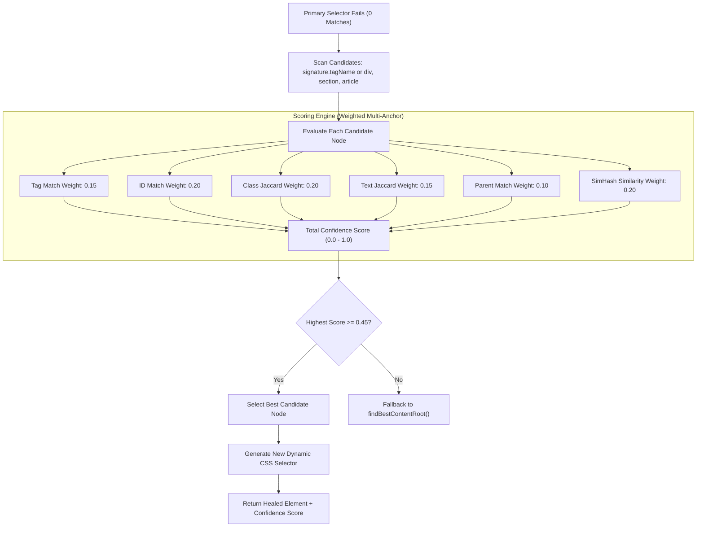

# 🧬 Adaptive Self-Healing Engine: Scrapi v2.0

## 1. Problem Statement: The Fragility of CSS Selectors

In traditional web scrapers, queries depend on rigid selectors (e.g. `#main-content > div.post-body > div.entry-text`). When website developers deploy redesigns, class obfuscation, or dynamic CSS modules (e.g. `.entry-text_a9x12`), these hardcoded selectors break, resulting in empty scrapes or runtime exceptions.

**Scrapi's Adaptive Engine** ([`src/parser/adaptive.js`](../src/parser/adaptive.js)) replaces brittle string selectors with **multi-anchor structural fingerprints** and **64-bit SimHash locality-sensitive hashing**, allowing the engine to automatically relocate elements when layouts change.

---

## 2. Element Fingerprint Schema

When an element is registered or selected in the Visual Picker, Scrapi computes an element fingerprint containing 8 multi-dimensional anchors:

```javascript
{
  "tagName": "article",
  "id": "main-post",
  "classes": ["post-item", "featured"],
  "textSnippet": "Breaking: Autonomous agents achieve state-of-the-art crawl performance...",
  "parentTagName": "main",
  "parentId": "primary",
  "path": "html > body > main#primary > article#main-post",
  "simHash": "d6fa7b3a86769261"
}
```

### Signature Properties:
1. `tagName` *(string)*: Element tag in lowercase.
2. `id` *(string|null)*: HTML ID attribute (if stable).
3. `classes` *(string[])*: Array of class names filtered to remove transient or randomized CSS hashes.
4. `textSnippet` *(string)*: First 120 characters of inner text used for semantic verification.
5. `parentTagName` *(string)*: Tag of immediate parent node.
6. `parentId` *(string|null)*: ID of immediate parent node.
7. `path` *(string)*: CSS ancestor path string from `html` down to the target node.
8. `simHash` *(string)*: 64-bit hex representation of the DOM subtree structure.

---

## 3. 64-Bit SimHash & Locality-Sensitive Hashing ([`src/parser/simhash.js`](../src/parser/simhash.js))

Standard cryptographic hashes (MD5, SHA-256) exhibit the **avalanche effect**: changing a single character completely alters the hash output. In contrast, **SimHash** is a locality-sensitive hash where similar inputs produce similar bit patterns.



### 3.1 Algorithm
1. Tokenizes the element into weighted structural features (tag names have weight 4, class tokens have weight 2, text n-grams have weight 1).
2. Computes a 64-bit FNV-1a hash for each token.
3. Initializes a 64-element accumulator vector $V = [0, 0, \dots, 0]$.
4. For each hash bit $i \in [0, 63]$:
   - If bit $i$ is `1`, $V[i] += \text{weight}$.
   - If bit $i$ is `0`, $V[i] -= \text{weight}$.
5. Generates the final 64-bit fingerprint: bit $i$ is `1` if $V[i] > 0$, else `0`.

### 3.2 Similarity via Hamming Distance
The similarity between two elements with fingerprints $h_1$ and $h_2$ is computed directly from their Hamming distance (number of differing bits):

$$\text{HammingDist}(h_1, h_2) = \text{popcount}(h_1 \oplus h_2)$$

$$\text{Similarity}(h_1, h_2) = 1.0 - \frac{\text{HammingDist}(h_1, h_2)}{64}$$

- **Identical DOMs**: Hamming distance $0 \implies \text{Similarity} = 1.0$ (100%).
- **Minor Redesign**: Hamming distance $\le 12 \implies \text{Similarity} \ge 0.81$ (81%).

---

## 4. The Self-Healing Relocation Algorithm (`AdaptiveEngine.relocate`)

When a primary CSS selector yields zero matches, [`AdaptiveEngine.relocate($, signature, url)`](../src/parser/adaptive.js) initiates recovery:



### Confidence Weights Breakdown:
- **ID Equality** ($0.20$): Exact match on `id`.
- **Class Jaccard Index** ($0.20$): Intersection over union of class tokens.
- **SimHash Similarity** ($0.20$): Structural subtree similarity via Hamming distance.
- **Tag Match** ($0.15$): Exact match on tag name.
- **Text Similarity** ($0.15$): Jaccard word-set similarity on the first 120 text characters.
- **Parent Context** ($0.10$): Matches on parent tag and parent ID.

If the top-scoring candidate scores $\ge 0.45$, the element is deemed recovered. The engine constructs a new unique CSS selector (e.g. `main#primary > article.post_v2`) and returns the healed element.

---

## 5. SQLite Fingerprint Storage

Fingerprints are saved and retrieved via the SQLite table `element_fingerprints` ([`src/storage.js`](../src/storage.js)):

```sql
CREATE TABLE IF NOT EXISTS element_fingerprints (
  id INTEGER PRIMARY KEY AUTOINCREMENT,
  domain TEXT NOT NULL,
  name TEXT NOT NULL,
  signature TEXT NOT NULL, -- JSON string containing multi-anchor profile
  confidence REAL DEFAULT 1.0,
  updated_at DATETIME NOT NULL,
  UNIQUE(domain, name)
);
```

When an element is healed during a live crawl, Scrapi automatically updates the stored fingerprint in SQLite, creating an **adaptive feedback loop** that persists across scraping runs.
