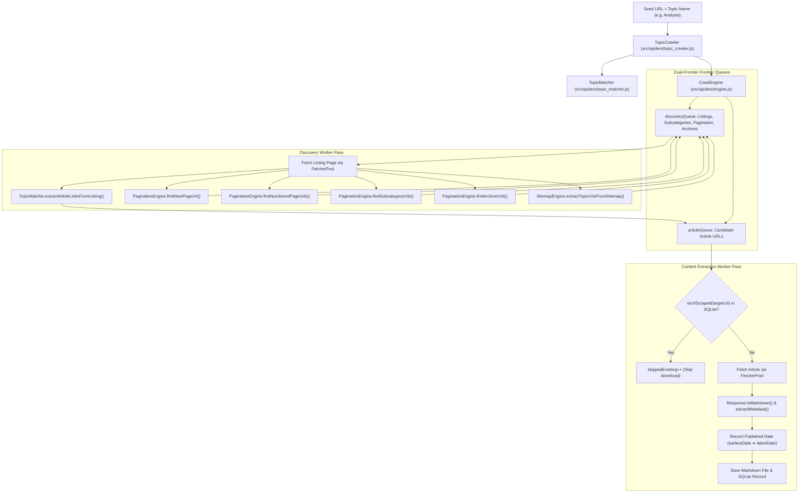

# 🕷️ Crawling Engine: Scrapi v2.0

## 1. Crawling Subsystem Architecture

The Crawling Subsystem ([`src/spiders/`](../src/spiders/)) provides intelligent, high-throughput, and exhaustive website scraping. It overcomes the traditional pitfall of crawlers getting lost in article pages by employing a **dual-frontier queue architecture**:



---

## 2. Core Components

### 2.1 `CrawlEngine` ([`src/spiders/engine.js`](../src/spiders/engine.js))
The central coordinator running concurrent asynchronous worker loops:
- **Concurrency & Throttling**: Runs $N$ concurrent workers (`options.concurrency`, default: 2) with polite millisecond delays (`options.delay`, default: 1000ms).
- **Dual Queues**:
  - `discoveryQueue`: High-priority queue containing category indexes, pagination links, and archives.
  - `articleQueue`: Content queue containing individual articles waiting to be extracted.
- **Dynamic Date Coverage Tracker**:
  ```javascript
  this.dateCoverage = {
    earliestDate: null,  // e.g. "2024-01-10"
    latestDate: null,    // e.g. "2026-10-14"
    byYear: {},          // { "2024": 120, "2025": 450, "2026": 210 }
    totalWithDates: 0
  };
  ```
  Dynamically tracks dates extracted from articles to monitor historical depth.
- **State Checkpoints**: Every 5 visited URLs, serializes queue state into SQLite table `spider_checkpoints` to allow safe resumption after interruptions.

---

### 2.2 `TopicCrawler` ([`src/spiders/topic_crawler.js`](../src/spiders/topic_crawler.js))
High-level orchestrator designed for exhaustive topic scraping:
- **Entrypoint Resolution (`resolveTopicEntrypoint`)**:
  1. Checks if the seed URL already matches the topic.
  2. Runs `discoverCategories(websiteUrl)` to find matching navigation links by name or URL slug.
  3. Falls back to standard conventional paths (`/<topic>/`, `/category/<topic>/`, `/topics/<topic>/`, `/section/<topic>/`).
- **Configuration**: Sets `exhaustive: true`, `maxPages: Infinity`, and `depth: Infinity` to ensure no arbitrary stopping conditions.

---

### 2.3 `TopicMatcher` ([`src/spiders/topic_matcher.js`](../src/spiders/topic_matcher.js))
Provides topic relevance scoring and noise path filtering:
- **Topic Profiling (`createProfile`)**: Converts raw topic names into normalized slugs, token arrays, and stem variations (e.g. `'analysis'` matches `analyses`, `analytics`, `analytical`).
- **Noise Filtering (`isIgnoredNoise`)**: Discards auth, cart, utility, and binary paths:
  ```javascript
  const NOISE_PATH_REGEX = /\/(login|logout|signin|signup|cart|checkout|wp-admin|feed|privacy|terms|contact)\b/i;
  const MEDIA_EXT_REGEX = /\.(jpg|jpeg|png|gif|svg|pdf|zip|mp4|css|woff|woff2)$/i;
  ```
- **Page Role Classification (`classifyPageRole`)**: Inspects URL patterns and DOM composition to categorize pages into:
  - `LISTING_PAGE`: URLs with pagination query parameters (`?page=2`, `/page/2/`), category paths (`/category/`), or pages containing $\ge 3$ article cards.
  - `ARCHIVE_PAGE`: URLs matching `/archive/` or year directories (`/2024/05/`).
  - `ARTICLE_PAGE`: Deep paths matching slug patterns or containing specific article content.
  - `DISCARD`: System noise, login, or binary assets.
- **Listing Article Link Extraction (`extractArticleLinksFromListing`)**: Targets article cards (`article`, `.post-item`, `.card`, `main a`) and excludes headers, footers, and sidebars.

---

### 2.4 `PaginationEngine` ([`src/spiders/pagination.js`](../src/spiders/pagination.js))
Exhaustively traverses listing pagination:
- **Next Page Detection (`findNextPageUrl`)**: Checks explicit HTML links (`link[rel="next"]`, `a.next`, `a[aria-label*="next" i]`) and anchor text patterns (`Next »`, `Older Posts`, `→`).
- **Numbered Page Discovery (`findNumberedPageUrls`)**: Identifies all numbered pagination buttons (`.pagination a`, `.page-numbers a`) in listing containers.
- **Child Subcategory Discovery (`findSubcategoryUrls`)**: Finds nested subcategories under the main topic (e.g. `/analysis/macro/`, `/analysis/crypto/`).
- **Archive Navigation Discovery (`findArchiveUrls`)**: Discovers historical archive links (`/archive/2024/`, `/2024/01/`).
- **Depletion Detection (`isListingDepleted`)**: Checks for end-of-results markers (`"no posts found"`, `"end of results"`, `"nothing found"`, HTTP 404/410) to prevent infinite loops.

---

### 2.5 `SitemapEngine` ([`src/spiders/sitemap.js`](../src/spiders/sitemap.js))
Ingests historical content directly from XML sitemaps:
- **Discovery**: Reads `robots.txt` for `Sitemap:` directives, falling back to `/sitemap.xml` and `/sitemap_index.xml`.
- **Filtering**: Recursively parses sitemap indices, extracting URLs matching the topic slug along with `<lastmod>` timestamps.

---

## 3. URL Deduplication & Termination

### 3.1 In-Memory Deduplication
The crawler maintains sets of visited URLs:
- `visitedListings`: Set of visited category and pagination URLs.
- `visitedArticles`: Set of visited article URLs.
- `visited`: Union of all visited URLs.
Before adding any URL to `discoveryQueue` or `articleQueue`, the engine checks whether it has already been processed or enqueued.

### 3.2 Persistent SQLite Deduplication (Incremental Mode)
Before fetching an article from `articleQueue`, the engine executes:
```javascript
if (!isListing && isIncrementalEligible && !this.options.noCache && isUrlScraped(targetUrl)) {
  this.visited.add(targetUrl);
  this.visitedArticles.add(targetUrl);
  this.skippedExisting++;
  continue; // Skip network download!
}
```
Using the SQLite index `idx_scrapes_url`, this check runs in $<1\text{ms}$, allowing subsequent crawls of a topic to skip existing content and extract only newly published articles.

### 3.3 Termination Conditions
A crawl terminates naturally when:
1. `discoveryQueue` is depleted (all categories, archives, and pagination traversed).
2. `articleQueue` is depleted (all discovered articles scraped).
3. `visited.size >= maxPages` (if a budget limit was explicitly set).
4. An abort signal is received from the user, CLI (`Ctrl+C`), or Web UI (`POST /api/topic/pause`).
