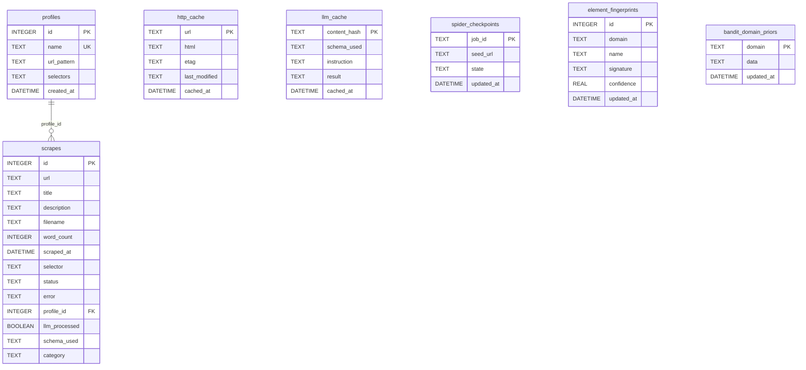

# 💾 Database & Storage: Scrapi v2.0

## 1. Storage Subsystem Overview

Scrapi v2.0 uses a dual-layer persistence model managed by [`src/storage.js`](../src/storage.js):
1. **Relational Metadata Layer**: An embedded SQLite database (`./data/scrapes.db`) managed via `better-sqlite3` configured with **Write-Ahead Logging (WAL)**.
2. **Document & Media Filesystem Layer**: Structured Markdown files, sidecar JSON files, and media assets saved in `./output/` structured by hostname and path.



---

## 2. SQLite Database Schemas & Tables

### 2.1 `scrapes` Table
Stores execution records for every scraped URL.
```sql
CREATE TABLE IF NOT EXISTS scrapes (
  id INTEGER PRIMARY KEY AUTOINCREMENT,
  url TEXT NOT NULL,
  title TEXT,
  description TEXT,
  filename TEXT,           -- Relative path to output Markdown file
  word_count INTEGER,
  scraped_at DATETIME NOT NULL,
  selector TEXT,           -- Selector or 'auto'
  status TEXT NOT NULL,    -- 'success' or 'failed'
  error TEXT,              -- Error message if failed
  profile_id INTEGER,      -- Optional FK to profiles table
  llm_processed BOOLEAN DEFAULT 0,
  schema_used TEXT,
  category TEXT            -- Topic or category tag
);

CREATE INDEX IF NOT EXISTS idx_scrapes_category ON scrapes(category);
CREATE INDEX IF NOT EXISTS idx_scrapes_scraped_at ON scrapes(scraped_at DESC);
CREATE INDEX IF NOT EXISTS idx_scrapes_url ON scrapes(url);
```
- **Indexes**: `idx_scrapes_url` allows instant $O(1)$ URL lookups for incremental deduplication during crawls.

---

### 2.2 `profiles` Table
Stores reusable visual selector profiles configured via the Web Dashboard.
```sql
CREATE TABLE IF NOT EXISTS profiles (
  id INTEGER PRIMARY KEY AUTOINCREMENT,
  name TEXT UNIQUE NOT NULL,
  url_pattern TEXT NOT NULL,
  selectors TEXT NOT NULL, -- JSON string mapping keys to CSS selectors
  created_at DATETIME NOT NULL
);
```

---

### 2.3 `http_cache` Table
Powers conditional HTTP caching for `StaticFetcher`.
```sql
CREATE TABLE IF NOT EXISTS http_cache (
  url TEXT PRIMARY KEY,
  html TEXT NOT NULL,
  etag TEXT,
  last_modified TEXT,
  cached_at DATETIME NOT NULL
);
```

---

### 2.4 `spider_checkpoints` Table
Stores serialized crawl frontier states for pause/resume.
```sql
CREATE TABLE IF NOT EXISTS spider_checkpoints (
  job_id TEXT PRIMARY KEY,
  seed_url TEXT NOT NULL,
  state TEXT NOT NULL,     -- JSON string containing queues, visited sets, date coverage
  updated_at DATETIME NOT NULL
);
```

---

### 2.5 `element_fingerprints` Table
Stores 64-bit SimHash and multi-anchor DOM signatures for self-healing selectors.
```sql
CREATE TABLE IF NOT EXISTS element_fingerprints (
  id INTEGER PRIMARY KEY AUTOINCREMENT,
  domain TEXT NOT NULL,
  name TEXT NOT NULL,
  signature TEXT NOT NULL, -- JSON string of 8-anchor signature
  confidence REAL DEFAULT 1.0,
  updated_at DATETIME NOT NULL,
  UNIQUE(domain, name)
);

CREATE INDEX IF NOT EXISTS idx_fingerprints_domain ON element_fingerprints(domain);
```

---

### 2.6 `bandit_domain_priors` Table
Persists reinforcement learning Beta distributions for domain defense detection.
```sql
CREATE TABLE IF NOT EXISTS bandit_domain_priors (
  domain TEXT PRIMARY KEY,
  data TEXT NOT NULL,      -- JSON string of { static: {alpha, beta}, dynamic: {...}, stealth: {...} }
  updated_at DATETIME NOT NULL
);
```

---

### 2.7 `llm_cache` Table
Stores responses from Anthropic Claude API queries to prevent repeated token expenditures.
```sql
CREATE TABLE IF NOT EXISTS llm_cache (
  content_hash TEXT PRIMARY KEY,
  schema_used TEXT,
  instruction TEXT,
  result TEXT,
  cached_at DATETIME NOT NULL
);
```

---

## 3. Filesystem Output Structure

Output files are saved to `./output/` (or a custom `--output` directory) using an intelligent hierarchical mapping strategy:

```text
output/
├── example.com/
│   ├── index.md                  # Root page scrape
│   ├── index-metadata.json       # Sidecar JSON metadata
│   ├── analysis/
│   │   ├── market-trends.md
│   │   ├── market-trends-metadata.json
│   │   ├── breakthrough.md
│   │   └── media/                # Downloaded media files
│   │       └── chart_1729100000_210.jpg
└── custom-category/
    └── post-1.md
```

### Path Mapping Logic (`saveMarkdownFile`)
1. Parses URL path: `https://example.com/analysis/market-trends/`
2. Normalizes hostname: `example.com`
3. Maps URL segments to subdirectories: `example.com/analysis/`
4. Base filename extracted from final slug: `market-trends.md`
5. Handles collisions: If `market-trends.md` already exists for a different URL, appends an incrementing counter (`market-trends_1.md`).
6. Sidecar JSON: Automatically writes `<filename>-metadata.json` containing the full structured metadata object alongside the `.md` file.
