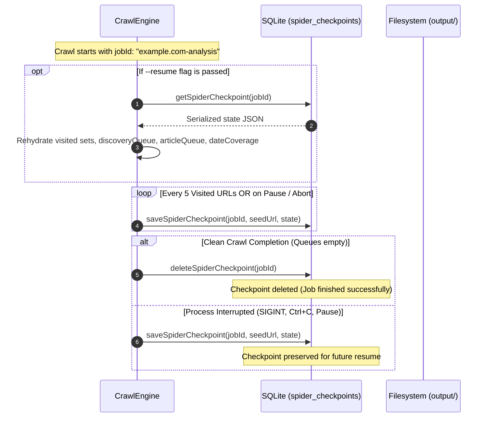

# ⏱️ Checkpoints & Resume: Scrapi v2.0

## 1. Overview: Fault-Tolerant Crawling

Crawling large websites or entire historical topics can take minutes or hours. Network dropouts, system restarts, or manual pauses shouldn't force a user to restart a 2,000-page crawl from scratch.

Scrapi v2.0 implements **transactional crawl checkpoints** in SQLite, enabling:
- Periodic auto-saving of frontier queues and state.
- Graceful pause and resume from the terminal or Web Dashboard.
- Seamless crash recovery via `--resume <jobId>`.

---

## 2. Checkpoint State Schema

Checkpoints are stored in the SQLite table `spider_checkpoints` keyed by a unique `job_id`:

```sql
CREATE TABLE IF NOT EXISTS spider_checkpoints (
  job_id TEXT PRIMARY KEY,
  seed_url TEXT NOT NULL,
  state TEXT NOT NULL,     -- Serialized JSON object
  updated_at DATETIME NOT NULL
);
```

### Serialized `state` JSON Structure:
```json
{
  "visited": [
    "https://example.com/analysis/",
    "https://example.com/analysis/page/2/",
    "https://example.com/analysis/breakthrough-2026"
  ],
  "visitedListings": [
    "https://example.com/analysis/",
    "https://example.com/analysis/page/2/"
  ],
  "visitedArticles": [
    "https://example.com/analysis/breakthrough-2026"
  ],
  "discoveryQueue": [
    { "url": "https://example.com/analysis/page/3/", "depth": 2, "type": "LISTING" }
  ],
  "articleQueue": [
    { "url": "https://example.com/analysis/genesis-2024", "depth": 2, "type": "ARTICLE" }
  ],
  "queue": [],
  "succeeded": 1,
  "failed": 0,
  "skippedExisting": 0,
  "mappedFilenames": [
    "example.com/analysis/breakthrough-2026.md"
  ],
  "failedUrls": [],
  "dateCoverage": {
    "earliestDate": "2026-10-14",
    "latestDate": "2026-10-14",
    "byYear": { "2026": 1 },
    "totalWithDates": 1
  },
  "topic": "Analysis",
  "options": {
    "concurrency": 2,
    "delay": 1000,
    "exhaustive": true
  }
}
```

---

## 3. Checkpoint Lifecycle



### 3.1 Periodic Checkpointing
In [`src/spiders/engine.js`](../src/spiders/engine.js), workers periodically persist state:
```javascript
if (this.jobId && this.visited.size % 5 === 0) {
  this.saveCheckpoint(seedUrl);
}
```
This ensures that at most 4 URL states could be lost in an unexpected system power loss.

### 3.2 Clean Completion vs. Interruption
- **On Clean Completion**: When all queues are exhausted, [`deleteSpiderCheckpoint(this.jobId)`](../src/storage.js) removes the checkpoint row since the job is complete.
- **On Interruption / Pause**: If `this.aborted` is triggered, [`this.saveCheckpoint(seedUrl)`](../src/spiders/engine.js) writes the final frontier state, preserving queues and date metrics.

---

## 4. How to Resume a Crawl

### 4.1 CLI Resume
Specify `--resume <jobId>` when launching a crawl:
```bash
# Resume an interrupted topic crawl
node src/cli.js topic https://example.com "Analysis" --resume example.com-analysis-topic-crawl

# Resume a general spider crawl
node src/cli.js spider https://example.com --resume example.com-spider
```

### 4.2 Web Dashboard Resume
1. In the Web UI, open the **Site Spider** or **Topic Crawl** tab.
2. If an active crawl is paused or was interrupted, the dashboard displays a **"Resume Job"** button.
3. Clicking **Resume** sends `POST /api/spider/resume` or calls `CrawlEngine.resumeFromCheckpoint(jobId)`.

### 4.3 Programmatic Node.js Resume
```javascript
import { CrawlEngine } from 'scrapi';

const engine = new CrawlEngine({
  jobId: 'example.com-analysis-topic-crawl',
  resume: true
});

const result = await engine.crawl('https://example.com/analysis/');
console.log(`Resumed crawl finished! Visited: ${result.visited}, Succeeded: ${result.succeeded}`);
```
