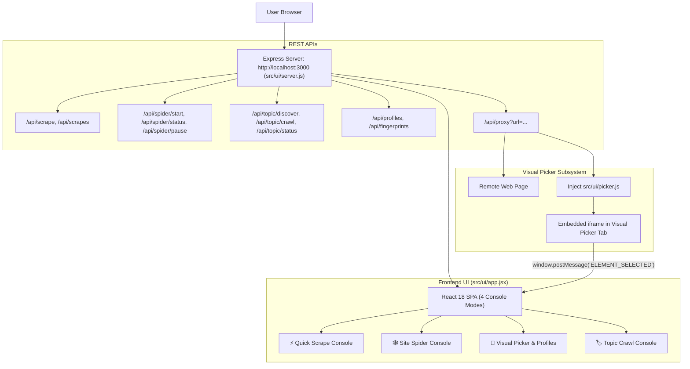

# 🖥️ Web Dashboard & Visual Picker: Scrapi v2.0

## 1. Web Dashboard Architecture

Scrapi v2.0 includes a modern, local web management interface ([`src/ui/`](../src/ui/)) composed of:
1. **Backend Server ([`src/ui/server.js`](../src/ui/server.js))**: Express 5 application providing REST APIs for scraping, spider job management, fingerprint storage, and an HTML proxy.
2. **Frontend Application ([`src/ui/app.jsx`](../src/ui/app.jsx))**: React 18 single-page application bundled with `esbuild` into [`src/ui/app.js`](../src/ui/app.js).
3. **Injected Picker Script ([`src/ui/picker.js`](../src/ui/picker.js))**: Interactive client-side overlay injected into proxied target web pages to capture clicked DOM elements.



---

## 2. The 4 Console Modes

### 2.1 ⚡ Quick Scrape
- Direct single-URL scraper testing.
- Allows selection of fetcher tier (`auto`, `static`, `dynamic`, `stealth`), CSS selector, media downloads, and LLM processing.
- Real-time display of execution timing, word count, metadata, and syntax-highlighted Markdown output.

### 2.2 🕸️ Site Spider
- Full-site recursive crawler control.
- Configuration for max pages, crawl depth, concurrency, rate-limiting delays, and checkpoint resume.
- Live progress stats: visited count, queue size, success/failure counts, and real-time spider log streaming.

### 2.3 🎯 Visual Selector Picker & Profiles
- Enables point-and-click selector generation without opening browser DevTools:
  1. The user enters a URL.
  2. The server fetches the page via `/api/proxy?url=...` and injects `picker.js`.
  3. The page renders inside an interactive iframe.
  4. Moving the mouse highlights candidate elements with a blue boundary box.
  5. Clicking an element computes both an optimal CSS selector and a 64-bit SimHash signature.
  6. Sends the selector to the parent React app via `window.postMessage`.
  7. The user saves the configuration as a named profile in SQLite table `profiles`.

### 2.4 🏷️ Topic Crawl Console
- Exhaustive category-focused scraper:
  - **Category Discovery**: Automatically analyzes the seed URL to populate clickable category pills (e.g. `[Analysis]`, `[Macro]`, `[Crypto]`).
  - **Exhaustive Toggle**: Enables unlimited traversal (`maxPages: Infinity`) to crawl from earliest publication date to current date.
  - **Dynamic Date Range Banner**: Live indicator showing discovered date range:
    ```text
    📅 Date Coverage: 2024-01-10 ➔ 2026-10-14  (3 succeeded, 0 skipped, 0 failed)
    ```
  - **Action Controls**: Start Crawl, Pause Job, Resume Checkpoint, and Cancel.

---

## 3. Backend REST API Endpoints (`src/ui/server.js`)

| Method | Endpoint | Description |
|---|---|---|
| `POST` | `/api/scrape` | Executes a single-page scrape and saves results to SQLite and disk. |
| `GET` | `/api/scrapes` | Returns a list of past scrapes with optional `?category=` filter. |
| `GET` | `/api/scrapes/:id` | Returns full details and Markdown text of a specific scrape record. |
| `GET` | `/api/proxy` | Proxies a target web page, rewriting links and injecting `picker.js`. |
| `GET` | `/api/profiles` | Returns all saved visual selector profiles from SQLite. |
| `POST` | `/api/profiles` | Saves a new selector profile (`{ name, url_pattern, selectors }`). |
| `DELETE` | `/api/profiles/:id` | Deletes a selector profile. |
| `POST` | `/api/spider/start` | Launches a background site crawl. |
| `GET` | `/api/spider/status` | Returns active spider statistics, queued counts, and recent logs. |
| `POST` | `/api/spider/pause` | Pauses active spider and writes an SQLite checkpoint. |
| `POST` | `/api/spider/stop` | Terminates active spider crawl. |
| `POST` | `/api/topic/discover` | Discovers topic and category links on a target website. |
| `POST` | `/api/topic/crawl` | Launches an exhaustive topic crawl using `TopicCrawler`. |
| `GET` | `/api/topic/status` | Polls live topic crawl statistics, queues, and date coverage. |
| `POST` | `/api/topic/pause` | Pauses active topic crawl and preserves checkpoint. |
| `POST` | `/api/topic/cancel` | Cancels active topic crawl. |
| `GET` | `/api/fingerprints` | Lists all saved self-healing element fingerprints. |
| `GET` | `/api/bandit/priors` | Inspects Bayesian Bandit domain defense distributions. |
| `GET` | `/api/stats` | Returns system health, database record counts, and cache statistics. |

---

## 4. Building the UI Bundle

The React interface is compiled into [`src/ui/app.js`](../src/ui/app.js) using `esbuild`:

```bash
npm run build:ui
```
This executes:
```bash
esbuild src/ui/app.jsx --bundle --outfile=src/ui/app.js --loader:.js=jsx --jsx-factory=React.createElement --jsx-fragment=React.Fragment --minify
```
Compilation takes $\sim 15\text{ms}$ and produces a compact single-file bundle ($\sim 66\text{KB}$).
