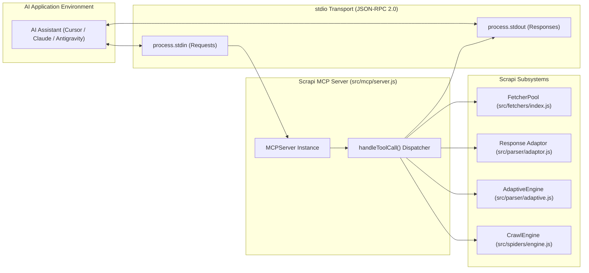

# 🤖 Model Context Protocol (MCP) Server: Scrapi v2.0

## 1. Overview: AI-Agent Integration

Scrapi v2.0 features a built-in **Model Context Protocol (MCP)** server ([`src/mcp/server.js`](../src/mcp/server.js)). 

MCP is an open standard created by Anthropic that allows AI applications (such as Claude Desktop, Cursor IDE, and Antigravity) to safely discover and execute external tools over standard input/output (`stdio`) using JSON-RPC 2.0.

By running `scrapi mcp`, AI agents can autonomously browse the web, scrape articles, run self-healing queries, and crawl site sections with full access to Scrapi's multi-tier fetchers and decision trees.

---

## 2. MCP Server Architecture



---

## 3. Exposed MCP Tools

The server exposes 4 tools with strict JSON Schema definitions:

### 3.1 `scrapi_fetch`
Fetches a web page and converts it into clean, token-efficient Markdown with structured metadata.

- **Input Schema**:
  ```json
  {
    "type": "object",
    "properties": {
      "url": { "type": "string", "description": "Target website URL" },
      "fetcher": { 
        "type": "string", 
        "enum": ["static", "dynamic", "stealth"], 
        "default": "static",
        "description": "Fetcher tier to use" 
      },
      "selector": { "type": "string", "description": "Optional CSS selector to target main content" },
      "images": { "type": "boolean", "default": false, "description": "Whether to include image markdown tags" }
    },
    "required": ["url"]
  }
  ```
- **Returns**: JSON object containing `url`, `title`, `description`, `wordCount`, `fetcher`, `timingMs`, and full `markdown`.

---

### 3.2 `scrapi_extract`
Extracts specific elements from a URL using CSS selectors, XPath queries, or Regex patterns.

- **Input Schema**:
  ```json
  {
    "type": "object",
    "properties": {
      "url": { "type": "string", "description": "Target website URL" },
      "css": { "type": "string", "description": "CSS selector query" },
      "xpath": { "type": "string", "description": "XPath query" },
      "regex": { "type": "string", "description": "Regex extraction pattern" },
      "fetcher": { "type": "string", "enum": ["static", "dynamic", "stealth"], "default": "static" }
    },
    "required": ["url"]
  }
  ```
- **Returns**: Array of matched element texts, attributes, or regex capture groups.

---

### 3.3 `scrapi_adaptive_query`
Executes an adaptive self-healing query on a page using multi-anchor DOM signatures, recovering content if website redesigns broke the original selector.

- **Input Schema**:
  ```json
  {
    "type": "object",
    "properties": {
      "url": { "type": "string", "description": "Target website URL" },
      "signature": {
        "type": "object",
        "description": "Element fingerprint (tagName, textSnippet, classes, id)",
        "properties": {
          "tagName": { "type": "string" },
          "textSnippet": { "type": "string" },
          "classes": { "type": "array", "items": { "type": "string" } },
          "id": { "type": "string" }
        },
        "required": ["tagName"]
      }
    },
    "required": ["url", "signature"]
  }
  ```
- **Returns**: Healed element text, recovered CSS selector anchor, and confidence score (0.0–1.0).

---

### 3.4 `scrapi_crawl`
Crawls a website seed URL to discover and extract connected pages up to a given page and depth budget.

- **Input Schema**:
  ```json
  {
    "type": "object",
    "properties": {
      "url": { "type": "string", "description": "Seed website URL" },
      "maxPages": { "type": "number", "default": 5, "description": "Maximum pages to crawl" },
      "depth": { "type": "number", "default": 2, "description": "Maximum depth level" }
    },
    "required": ["url"]
  }
  ```
- **Returns**: Array of scraped page objects (`url`, `title`, `filename`, `status`).

---

## 4. Configuring Scrapi with AI Applications

### 4.1 Claude Desktop Configuration
Add Scrapi to `claude_desktop_config.json`:
```json
{
  "mcpServers": {
    "scrapi": {
      "command": "node",
      "args": ["/absolute/path/to/Scrapi/src/cli.js", "mcp"]
    }
  }
}
```

### 4.2 Cursor IDE Configuration
In Cursor Settings ➔ **Features** ➔ **MCP Servers** ➔ **Add New MCP Server**:
- **Name**: `scrapi`
- **Type**: `command`
- **Command**: `node /absolute/path/to/Scrapi/src/cli.js mcp`

---

## 5. Starting the Server Manually
To test or verify the MCP server from the terminal:
```bash
node src/cli.js mcp
```
The process starts reading from `process.stdin` and writing JSON-RPC 2.0 frames to `process.stdout`.
