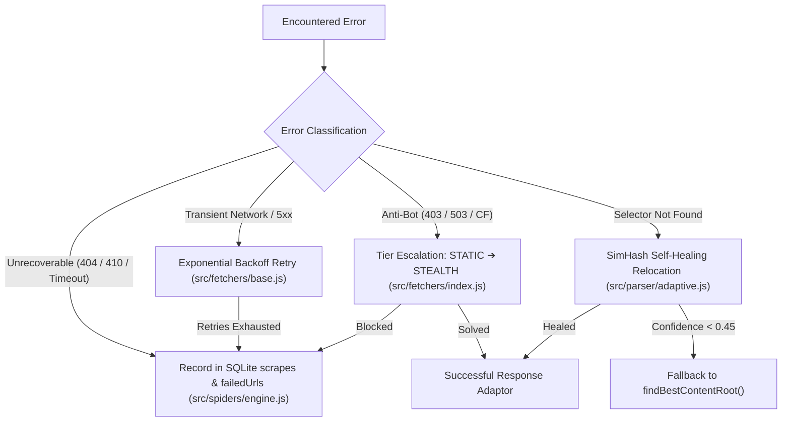

# 🛡️ Error Handling & Recovery: Scrapi v2.0

## 1. Error Taxonomy & Strategies

Scrapi categorizes errors into specific operational classes, applying tailored recovery mechanisms for each:



---

## 2. Retry Logic & Exponential Backoff

In [`src/fetchers/base.js`](../src/fetchers/base.js), requests encountering transient failures (network reset, socket hang up, HTTP 429, HTTP 500, 502, 503, 504) execute automatic retries:

- **Max Retries**: 2 retries (3 total attempts).
- **Backoff Formula**:
  $$\text{Delay} = 1000\text{ms} \times 2^{\text{attempt}} + \text{random}(0, 500)\text{ms}$$
- **Non-Retryable Errors**: HTTP 400, 401, 404, and 410 errors are not retried to avoid useless traffic.

---

## 3. Anti-Bot Challenge Handling

When an endpoint returns a Cloudflare Turnstile or anti-bot challenge:
1. `StaticFetcher` captures the 403 or 503 challenge page.
2. `TierRouterTree` detects challenge signatures:
   - `cf-browser-verification`
   - `challenges.cloudflare.com`
   - `turnstile`
   - `perimeterx`
3. If auto-escalation is enabled, `FetcherPool` discards the static response and launches `StealthyFetcher`.
4. `StealthyFetcher` opens the target page in an evasive Playwright browser context, locates the Turnstile challenge iframe, and simulates human cursor movement to check the box.
5. If the challenge clears within 10 seconds, the response returns successfully. If blocked, an informative error is logged without crashing the process.

---

## 4. Redirects & Canonical URL Reconciliation

Websites frequently redirect URLs (e.g. `http` ➔ `https`, non-trailing slash ➔ trailing slash, or renamed slugs):
- **Axios & Playwright**: Automatically follow HTTP 301, 302, 307, and 308 redirects.
- **Canonical Reconciliation**: In [`src/parser/adaptor.js`](../src/parser/adaptor.js), `Response.extractMetadata()` checks `<link rel="canonical" href="...">`. If the canonical URL differs from the requested seed URL, the canonical URL is recorded in `metadata.canonical_url`, preventing duplicate scrapes of alias URLs.

---

## 5. Crawl Failure Logging & Inaccessible URLs

During multi-page crawls, `CrawlEngine` isolates failures so a single broken page never halts the entire crawl:

1. **Per-Worker Isolation**: Every page fetch is enclosed in a worker `try / catch` block:
   ```javascript
   try {
     const response = await this.fetcherPool.fetch(targetUrl, ...);
     // Process page...
   } catch (err) {
     this.failed++;
     dbRecord.error = err.message;
     this.failedUrls.push({
       url: targetUrl,
       error: err.message,
       timestamp: new Date().toISOString()
     });

     if (!this.options.noDb) {
       insertScrape(dbRecord); // Save failed record with error text
     }
   }
   ```
2. **SQLite Failure Tracking**: Failed URLs are recorded in the `scrapes` table with `status = 'failed'` and the exact error string in the `error` column.
3. **Summary Inspection**: At crawl completion, the final report includes the count of failed URLs and an array of all failure details:
   ```javascript
   {
     visited: 100,
     succeeded: 98,
     failed: 2,
     failedUrls: [
       { url: "https://example.com/dead-link", error: "Request timeout (15000ms)" }
     ]
   }
   ```
