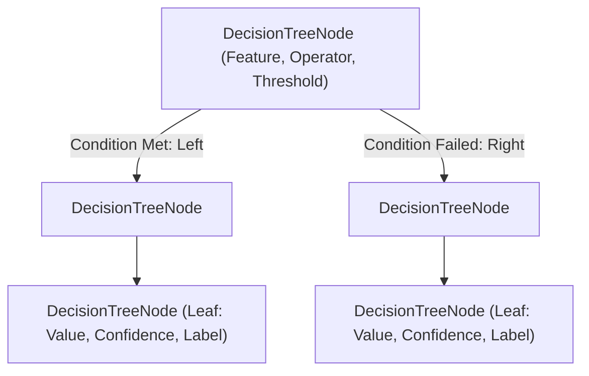
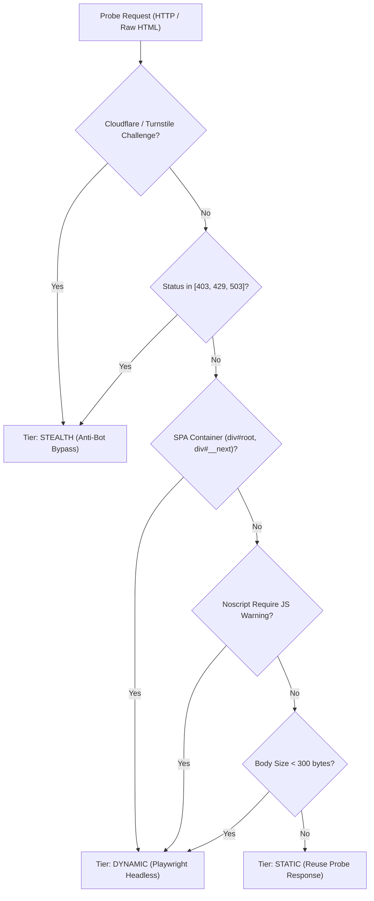
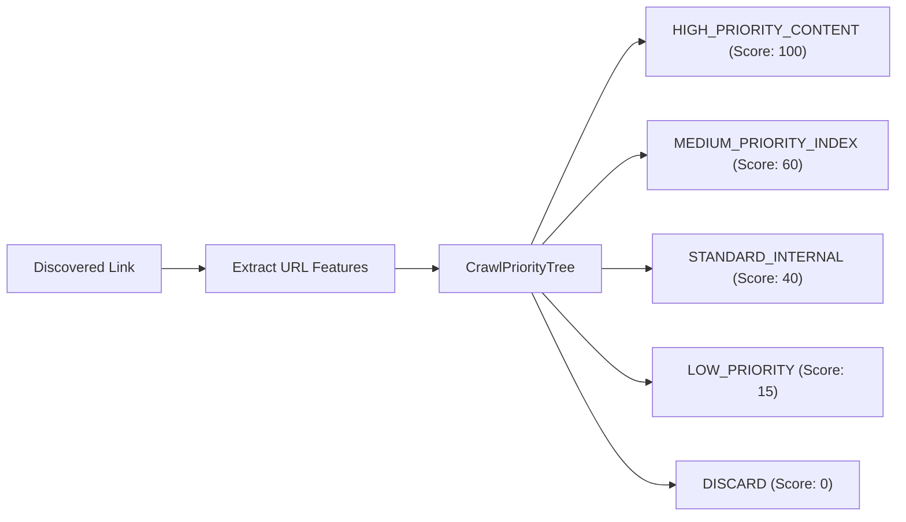

# Autonomous Decision Tree Engine in Scrapi

## Executive Summary
Scrapi incorporates a zero-dependency, pure JavaScript CART (Classification and Regression Trees) Decision Tree subsystem designed for sub-millisecond, deterministic heuristics. By evaluating HTTP signals, DOM topologies, and URL syntax, Scrapi autonomously solves three core web scraping bottlenecks:

1. **Autonomous Fetcher Tier Routing (`TierRouterTree`)**: Automatically routes requests between `static` (HTTP keep-alive), `dynamic` (Playwright headless Chromium), and `stealth` (Cloudflare Turnstile bypass) without trial-and-error.
2. **DOM Content Extraction & Boilerplate Pruning (`ContentExtractorTree`)**: Scores and classifies DOM nodes (`MAIN_CONTENT`, `BOILERPLATE`, `NOISE`) using link density, text volume, and lexical tokens to isolate the true article root.
3. **Crawl Frontier Prioritization (`CrawlPriorityTree`)**: Dynamically scores and ranks discovered URLs so content pages are crawled before pagination and utility noise.

---

## 1. Core Architecture & CART Implementation

The decision tree engine is located in [`src/trees/engine.js`](../src/trees/engine.js).



### Key Engine Primitives
- **`DecisionTreeNode`**: Represents either an internal split node (with `feature`, `operator`, `threshold`, `left`, `right`) or a terminal leaf (with `value`, `confidence`, `label`, `metadata`).
- **Supported Operators**: `<`, `<=`, `>`, `>=`, `==`, `!=`, `in` (set membership), and `contains` (substring / array search).
- **Explainability**: Every traversal records an exact step-by-step reasoning trace:
  ```json
  [
    "[hasCloudflareChallenge: false] == true ➔ NO",
    "[statusCode: 200] in [403, 429, 503] ➔ NO",
    "[hasAppShell: false] == true ➔ NO",
    "[bodyLength: 45000] > 1000 ➔ YES"
  ]
  ```
- **Serialization**: Complete tree structures can be exported to JSON via `.toJSON()` and restored via `.fromJSON()`.

---

## 2. Autonomous Fetcher Tier Routing (`TierRouterTree`)

When a scrape is initiated with `fetcher: 'auto'` (the default across CLI, API, and Web Console), Scrapi executes an initial static probe and evaluates the probe signals against the tier routing tree:



### Zero-Overhead Optimization
If `TierRouterTree` determines that `static` is optimal, Scrapi **reuses the probe response directly**. Zero duplicate network requests are made.

---

## 3. DOM Content Extraction (`ContentExtractorTree`)

The content extractor tree classifies DOM candidate elements by extracting:
- **`linkDensity`**: Proportion of text wrapped in anchor tags (`anchorTextLength / totalTextLength`).
- **`textLength`**: Total text content length in characters.
- **`pTagRatio`**: Density of `<p>` paragraph tags.
- **`positiveTokens` / `negativeTokens`**: Heuristic class and ID tokens (`article`, `story`, `content` vs `sidebar`, `footer`, `nav`, `widget`).

### Decision Matrix

| Link Density | Text Length | Negative Tokens | Classification | Base Score Weight |
|---|---|---|---|---|
| `< 0.35` | `> 300` | `<= 1` | `MAIN_CONTENT` | `1.0` |
| `> 0.60` | Any | Any | `NOISE` | `0.01` |
| Any | `< 80` | Any | `NOISE` | `0.01` |
| Any | Any | `> 2` | `BOILERPLATE` | `0.10` |

---

## 4. Crawl Frontier Prioritization (`CrawlPriorityTree`)

In recursive spider and crawl jobs, candidate links are scored and prioritized before being queued:



1. **`HIGH_PRIORITY_CONTENT` (Rank 100)**: Article slugs, date patterns (`/2026/10/slug`), blog posts, documentation pages.
2. **`MEDIUM_PRIORITY_INDEX` (Rank 60)**: Pagination (`?page=2`, `/page/3`), category listings (`/category/tech`).
3. **`STANDARD_INTERNAL` (Rank 40)**: Standard same-origin internal hyperlinks.
4. **`LOW_PRIORITY` (Rank 15)**: Utility pages (`privacy`, `terms`, `about`, `contact`).
5. **`DISCARD` (Rank 0)**: Non-HTML binaries (`.jpg`, `.png`, `.pdf`, `.zip`, `.js`, `.css`) or login/admin endpoints (`/wp-login.php`, `cdn-cgi`).

---

## 5. Performance Benchmarks

Measured using the Scrapi automated benchmark suite on a standard Node.js v18 runtime:

| Metric | Result |
|---|---|
| **TierRouterTree Inference Throughput** | ~9,000 ops/sec |
| **TierRouterTree Decision Latency** | ~110 µs per decision |
| **Pure Rule Traversal Latency (Pre-parsed Features)** | < 15 µs |
| **External Dependencies** | 0 (Pure Standard JavaScript) |
