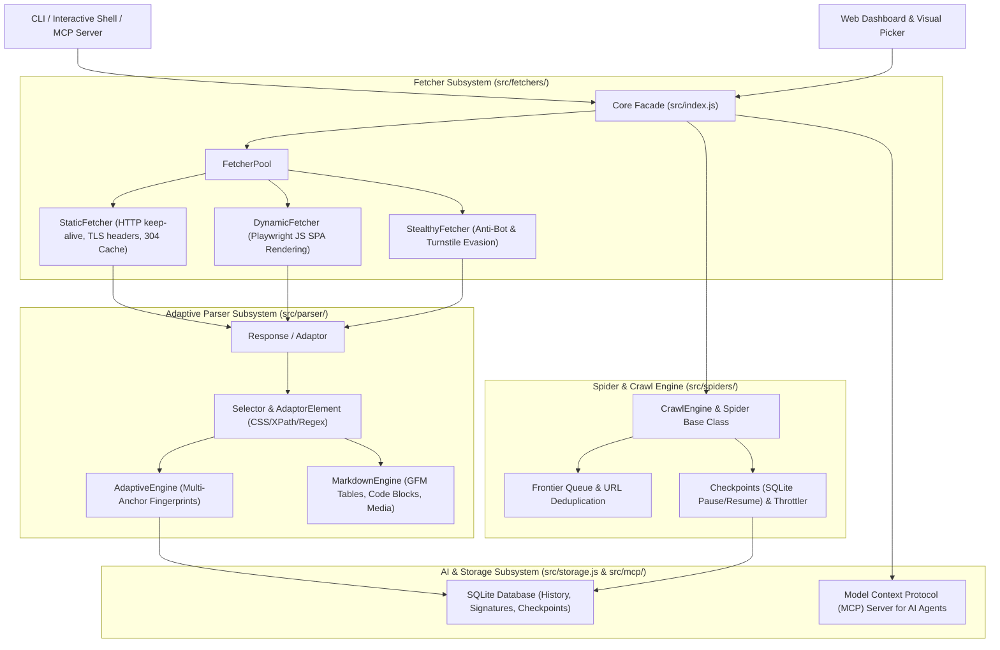

# 🏛️ Scrapi v2.0 Architecture Guide (Scrapling Engine)

This document outlines the complete architectural overhaul of **Scrapi (v2.0)** based on [D4Vinci/Scrapling](https://github.com/D4Vinci/Scrapling).

---

## 🏗️ System Architecture



---

## 📦 Core Subsystems

### 1. Progressive Multi-Tier Fetcher Subsystem (`src/fetchers/`)
* **`BaseFetcher`** ([`src/fetchers/base.js`](file:///Users/alpha/Desktop/Project%20report/Scrapi/src/fetchers/base.js)): Base class implementing retries with exponential backoff & jitter, proxy rotation, and user-agent generation.
* **`StaticFetcher`** ([`src/fetchers/static.js`](file:///Users/alpha/Desktop/Project%20report/Scrapi/src/fetchers/static.js)): Ultra-fast HTTP client leveraging connection pooling, TLS-like headers, automatic gzip/brotli decompression, conditional ETag/304 HTTP caching, and rate-limit backoff.
* **`DynamicFetcher`** ([`src/fetchers/dynamic.js`](file:///Users/alpha/Desktop/Project%20report/Scrapi/src/fetchers/dynamic.js)): Playwright headless browser client for rendering dynamic JavaScript single-page apps (SPAs), selector waiting, and auto-scrolling.
* **`StealthyFetcher`** ([`src/fetchers/stealth.js`](file:///Users/alpha/Desktop/Project%20report/Scrapi/src/fetchers/stealth.js)): Anti-bot evasion engine that masks `navigator.webdriver`, simulates Chrome runtime, handles permissions queries, injects canvas noise, and automates Cloudflare Turnstile challenge solving.
* **`FetcherPool`** ([`src/fetchers/index.js`](file:///Users/alpha/Desktop/Project%20report/Scrapi/src/fetchers/index.js)): Factory for managing fetchers with automatic tier escalation (`Static` $\rightarrow$ `Dynamic` $\rightarrow$ `Stealth`).

### 2. Adaptive Parser Subsystem (`src/parser/`)
* **`Response` / `Adaptor`** ([`src/parser/adaptor.js`](file:///Users/alpha/Desktop/Project%20report/Scrapi/src/parser/adaptor.js)): Unified response object returned by all fetchers providing `.css()`, `.xpath()`, `.toMarkdown()`, `.extractMetadata()`, and `.json()`.
* **`SelectorList` & `AdaptorElement`** ([`src/parser/selector.js`](file:///Users/alpha/Desktop/Project%20report/Scrapi/src/parser/selector.js)): Fluent query builder supporting CSS selectors, XPath expressions, regex patterns, text filtering (`hasText`, `exactText`), attribute extraction, and chaining.
* **`AdaptiveEngine`** ([`src/parser/adaptive.js`](file:///Users/alpha/Desktop/Project%20report/Scrapi/src/parser/adaptive.js)): Multi-anchor structural fingerprinting (tag hierarchy, text similarity, class overlap, text-to-tag ratio) that auto-relocates target elements when website DOM structures mutate.
* **`MarkdownEngine`** ([`src/parser/markdown.js`](file:///Users/alpha/Desktop/Project%20report/Scrapi/src/parser/markdown.js)): High-fidelity HTML-to-Markdown conversion with GFM tables, fenced code blocks, media rewriting/extraction, and YAML frontmatter generation.

### 3. Spider & Crawling Engine (`src/spiders/`)
* **`Spider` Base Class** ([`src/spiders/spider.js`](file:///Users/alpha/Desktop/Project%20report/Scrapi/src/spiders/spider.js)): Scrapy-inspired lifecycle hooks (`startRequests()`, `parse()`, `onItemScraped()`, `onError()`, `onComplete()`).
* **`CrawlEngine`** ([`src/spiders/engine.js`](file:///Users/alpha/Desktop/Project%20report/Scrapi/src/spiders/engine.js)): Concurrent async crawling loop with link frontier queues, URL deduplication, depth budgeting, auto-throttling, and pause/resume checkpoints (`spider_checkpoints`).

### 4. Model Context Protocol (MCP) Server (`src/mcp/`)
* **`MCPServer`** ([`src/mcp/server.js`](file:///Users/alpha/Desktop/Project%20report/Scrapi/src/mcp/server.js)): Built-in JSON-RPC stdio server exposing `scrapi_fetch`, `scrapi_extract`, `scrapi_adaptive_query`, and `scrapi_crawl` for AI coding assistants like Claude, Cursor, and Antigravity.

### 5. CLI & Interactive Shell (`src/cli/`)
* **`startShell`** ([`src/cli/shell.js`](file:///Users/alpha/Desktop/Project%20report/Scrapi/src/cli/shell.js)): REPL shell for live testing of selectors, fetchers, and responses.
* **`cli.js`** ([`src/cli.js`](file:///Users/alpha/Desktop/Project%20report/Scrapi/src/cli.js)): Unified CLI entry point for `scrape`, `crawl`, `spider`, `shell`, `mcp`, `serve`, `list`, and `show`.

---

## 💻 CLI Cheat Sheet

```bash
# 1. Multi-tier scraping
node src/cli.js scrape https://example.com --fetcher static
node src/cli.js scrape https://example.com --fetcher dynamic
node src/cli.js scrape https://example.com --fetcher stealth

# 2. Interactive REPL shell
node src/cli.js shell https://example.com

# 3. Model Context Protocol (MCP) server
node src/cli.js mcp

# 4. Recursive website spider with pause/resume checkpoint
node src/cli.js spider https://example.com -d 3 -m 50 -c 4 --delay 500
node src/cli.js spider https://example.com --resume example.com-spider

# 5. Web UI dashboard
node src/cli.js serve --port 3000
```
