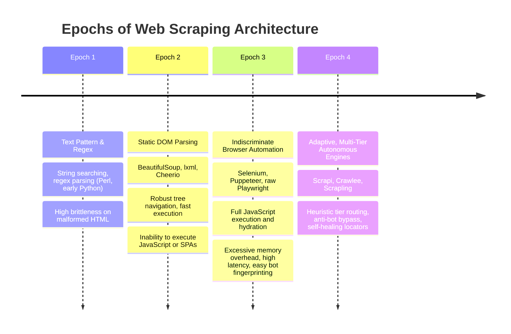

# Chapter 1: Literature Review & Comparative Analysis

## 1.1 Evolution of Web Scraping Paradigms

Web data extraction has evolved through four major architectural epochs over the past two decades.

### Epoch 1: Lexical Pattern Matching (1995–2005)
Early extraction pipelines relied on regular expressions and lexical parsers. While computationally minimal ($O(N)$ with respect to document size), this approach violates Chomsky hierarchy constraints: HTML is a context-free grammar with arbitrarily nested structures that cannot be reliably parsed by regular grammars.

### Epoch 2: Static DOM Tree Parsers (2005–2015)
The emergence of BeautifulSoup, lxml, and Cheerio introduced tree-based parsing (DOM) adhering to the W3C specifications. Parsers construct an In-Memory Object Model allowing CSS selectors and XPath queries.
- **Strengths**: High execution throughput (~30,000–50,000 ops/sec in V8/C extensions), low memory footprint (<5 MB per document).
- **Critical Limitation**: Blind to client-side DOM mutations executed by JavaScript runtimes (React, Vue, Next.js, Angular).

### Epoch 3: Indiscriminate Browser Automation (2015–2022)
With the rise of Single Page Applications (SPAs), developers turned to headless browser drivers (Selenium WebDriver, Puppeteer, Playwright).
- **Critical Trade-Off**: Launching a full Chromium instance consumes 150 MB–350 MB of resident memory per process, incurs cold-start latencies of 800 ms–2,500 ms, and triggers modern anti-bot detection suites through standard automation flags (`navigator.webdriver`, missing codecs, standardized canvas signatures).

### Epoch 4: Adaptive, Multi-Tier Autonomous Engines (2022–Present)
Modern engineering demands hybrid architectures that dynamically negotiate the trade-off between resource consumption and rendering fidelity. Frameworks like **Scrapi** bridge static high-throughput HTTP clients with headless Chromium instances through autonomous decision logic, adaptive self-healing selectors, and anti-fingerprinting stealth masks.

---

## 1.2 Survey of Academic Content Extraction Algorithms

Automated extraction of primary article content from arbitrary web pages (known in academic literature as *Web Page Cleaning* or *Boilerplate Removal*) has been extensively studied.

### 1. Boilerpipe (Kohlschütter, Fankhauser, and Nejdl, 2010)
Boilerpipe treats an HTML page as a sequence of text blocks, classifying each block as either "headline", "content", or "boilerplate" using quantitative block features:
- Text density: Length of text divided by the number of tokens.
- Link density: Proportion of words belonging to anchor tags.
- *Limitation*: Boilerpipe operates on flattened text block sequences, discarding structural hierarchical parent-child relationships within the DOM.

### 2. CETR: Content Extraction via Text Density and Tag Ratio (Sun et al., 2011)
CETR models content density as a continuous function across DOM depth:
$$\text{Tag Ratio} = \frac{\text{Count of HTML Tags in Node}}{\text{Total DOM Tags}}$$
CETR demonstrates that primary content regions exhibit localized peaks in text-to-tag ratios accompanied by low link density.

### 3. Readability Heuristics (Arc90 / Mozilla Firefox)
Mozilla's Readability engine employs a rule-based scoring mechanism:
- Positive semantic matches (`article`, `body`, `content`, `entry`, `main`, `post`) confer score bonuses (+25 points).
- Negative semantic matches (`combx`, `comment`, `community`, `disqus`, `extra`, `foot`, `header`, `menu`, `remark`, `rss`, `shoutbox`, `sidebar`, `sponsor`, `ad`) confer heavy penalties (-25 points).
- Paragraphs (`
`) with length $> 50$ characters contribute positive cumulative weight.

### The Scrapi Synthesis: Tree-Structured Decision Heuristics
Scrapi synthesizes the strengths of Boilerpipe, CETR, and Readability into a unified **`ContentExtractorTree`** (CART architecture). Rather than computing flat linear scores, Scrapi evaluates conditional split nodes in microsecond intervals, weighting logarithmic text volume with link density and token sentiments to isolate the true article root.

---

## 1.3 Comparative Framework Analysis

| Dimension | Scrapi v2.0 | Scrapy (Python) | BeautifulSoup4 (Python) | Crawlee (Node.js) | Scrapling (Python) |
|---|---|---|---|---|---|
| **Runtime / Engine** | Node.js (V8) | Python (Twisted) | Python (CPython) | Node.js (V8) | Python (Camoufox) |
| **Execution Model** | Async Non-blocking (Event Loop) | Twisted Async Reactor | Synchronous | Async Non-blocking | AsyncIO / Sync |
| **Parsing Engine** | Cheerio + XPath + CSS | Parsel (lxml) | lxml / html.parser | Cheerio / Playwright | Parsel / lxml |
| **DOM Navigation** | Fluent Chainable Adaptor | XPath / CSS Selectors | Custom pythonic API | Cheerio API | Scrapling Adaptor |
| **Tier Routing Strategy** | **Autonomous CART Decision Tree** | Manual Spider Configuration | Static only | Manual configuration | Manual / Adaptive |
| **Anti-Bot Defense** | Built-in Turnstile / Mask Engine | Third-party middleware | None | Camoufox / Fingerprints | Camoufox stealth |
| **Self-Healing Locators** | **Yes (Weighted Structural Fingerprints)** | No | No | No | Yes (Basic Fingerprint) |
| **Crawl Prioritization** | **CART Tree-Ranked Frontier** | Priority Queue (Integer) | None | RequestQueue | Basic priority |
| **Native AI/LLM Bridge** | **Yes (Zod Structured + MCP Server)** | No | No | No | No |
| **Average Memory per Worker** | **~25 MB (Static) / ~180 MB (Dynamic)** | ~45 MB | ~20 MB | ~150 MB–300 MB | ~120 MB–250 MB |

---

## 1.4 Critical Research Gaps Addressed by Scrapi

1. **The Static-Dynamic Dilemma**: Prior tools required engineers to guess whether a page required JavaScript rendering before launching the scrape. Scrapi eliminates manual guessing via automated probe heuristics that decide the optimal tier in $< 110\ \mu\text{s}$.
2. **Selector Fragility Under Continuous Deployment**: Web applications deployed in modern CI/CD pipelines frequently randomize CSS class names (e.g., CSS Modules `article_x7B3z`, Tailwind obfuscation). Static selectors break instantly. Scrapi's adaptive engine provides structural self-healing without requiring external ML models.
3. **Crawl Frontier Waste**: Standard BFS/DFS crawlers expend bandwidth and CPU on redundant administrative, login, and binary asset pages. Scrapi's CART priority classifier categorizes URLs before fetching, ensuring high-value content is scraped first.
