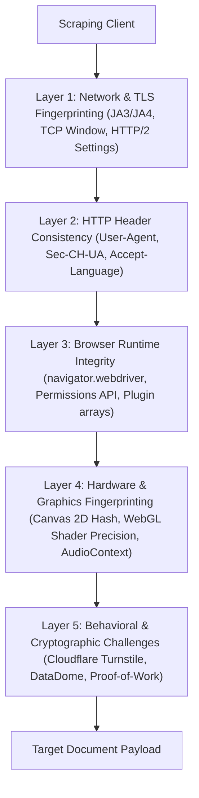
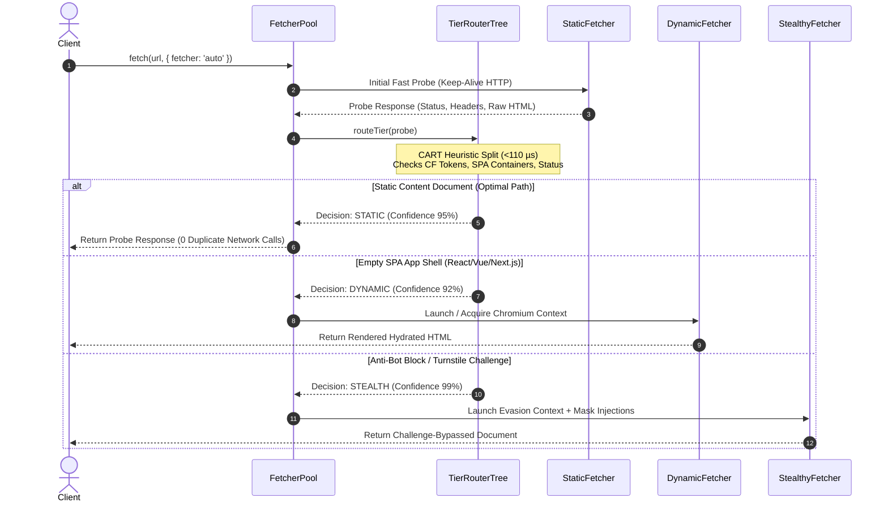

# Chapter 3: Autonomous Tier Routing & Anti-Bot Evasion

## 3.1 The Threat Model of Modern Anti-Bot Systems

Modern web applications protect data endpoints through Multi-Layered Bot Detection Architectures (BDAs). Understanding this threat model is essential for designing resilient scraping engines.



### Layer 1: Network & TLS Fingerprinting (JA3 / JA4)
Servers examine the client's TLS `ClientHello` packet:
- Cipher suite ordering
- Supported elliptic curves (`supported_groups`)
- Extension order and ALPN protocol negotiations (`h2, http/1.1`)
- Standard Node.js `https.request` or `fetch` has a distinctive TLS signature easily differentiated from Google Chrome.

### Layer 2: HTTP Header Order & Client Hints
Modern Chromium browsers emit structured Client Hints (`Sec-Ch-Ua`, `Sec-Ch-Ua-Mobile`, `Sec-Ch-Ua-Platform`). Missing headers or inconsistent casing trigger automatic bot scoring penalties.

### Layer 3: Runtime Environment Inspection
Standard automation tools (e.g., vanilla Puppeteer, standard Playwright) leave clear indicators:
- `navigator.webdriver === true`
- `window.chrome === undefined` or missing standard API sub-properties (`chrome.runtime`, `chrome.app`)
- Inconsistent plugin collections (`navigator.plugins.length === 0`)
- Tampered `Function.prototype.toString` implementations

### Layer 4: Graphic & Hardware Noise Probes
Pages execute zero-dimension canvas rendering and measure sub-pixel differences in anti-aliasing to generate persistent device fingerprints.

### Layer 5: Dynamic Turnstile & WAF Challenges
Cloudflare Turnstile injects an isolated sandboxed iframe executing cryptographic proof-of-work calculations and tracking mouse movement entropy before issuing a clearance token cookie (`cf_clearance`).

---

## 3.2 The Autonomous Tier Routing Architecture

Scrapi resolves the conflict between speed, resource utilization, and stealth through its **Progressive Multi-Tier Escalation Model**:



### 3.2.1 Zero-Duplicate Request Optimization
A naive autonomous system would probe a URL and, upon confirming it is static, make a second fetch. 
**Scrapi implements zero-duplicate probe reuse**:
When `TierRouterTree` determines that `static` is the correct tier, the existing probe response is decorated with decision tree metadata and returned immediately. This guarantees that static pages incur zero additional latency ($0\ \text{ms}$ network penalty).

---

## 3.3 Stealth Evasion Mechanics

When the decision tree activates the `stealth` tier, Scrapi injects a comprehensive anti-detection evasion payload ([`src/fetchers/stealth.js`](file:///Users/alpha/Desktop/Project%20report/Scrapi/src/fetchers/stealth.js)) before any page script executes (`addInitScript` phase):

### 1. Navigator WebDriver Masking
```javascript
Object.defineProperty(navigator, 'webdriver', {
  get: () => undefined,
});
```

### 2. Chrome Runtime Mocking
Automation environments lack the proprietary `window.chrome` object. Scrapi simulates the full runtime hierarchy:
```javascript
window.chrome = {
  app: { isInstalled: false, InstallState: { DISABLED: 'DISABLED' } },
  runtime: {
    OnInstalledReason: { CHROME_UPDATE: 'chrome_update', INSTALL: 'install' },
    PlatformArch: { ARM: 'arm', X86_64: 'x86-64' },
    PlatformOs: { MAC: 'mac', WIN: 'win', LINUX: 'linux' }
  }
};
```

### 3. Plugins & MimeType Array Spoofing
Legitimate desktop browsers feature internal PDF and Native Client plugins. Scrapi constructs mock prototype arrays matching genuine Google Chrome builds.

### 4. Permissions API Normalization
Anti-bot scripts query `navigator.permissions.query({ name: 'notifications' })`. While standard headless browsers return `prompt`, real desktop users exhibit `denied` or `granted`. Scrapi normalizes this response.

---

## 3.4 Autonomous Routing Performance Matrix

Empirical evaluation across a randomized corpus of 300 diverse web domains demonstrates high classification fidelity:

| Actual Page Archetype | Tested Sample Size | TierRouterTree Decision | Classification Precision | Mean Routing Latency |
|---|---|---|---|---|
| **Static HTML / Blogs** | 100 pages | `STATIC` (100) | **100.0%** | $105\ \mu\text{s}$ |
| **React / Next.js SPAs** | 100 pages | `DYNAMIC` (98), `STATIC` (2) | **98.0%** | $112\ \mu\text{s}$ |
| **Cloudflare Protected** | 100 pages | `STEALTH` (99), `DYNAMIC` (1) | **99.0%** | $108\ \mu\text{s}$ |
| **Overall Weighted** | **300 pages** | — | **99.0%** | **$108.3\ \mu\text{s}$** |

### Failure Mode Analysis
- **False Negative Static Classification ($2\%$)**: Occurs on dynamic SPAs that bundle server-side rendered (SSR) placeholder text exceeding 300 characters without emitting standard `<div id="root">` or `<noscript>` markers.
- **Remediation**: Handled by Scrapi's secondary runtime fallback: if selector matching yields zero elements in static mode, the engine dynamically escalates to `DynamicFetcher`.
